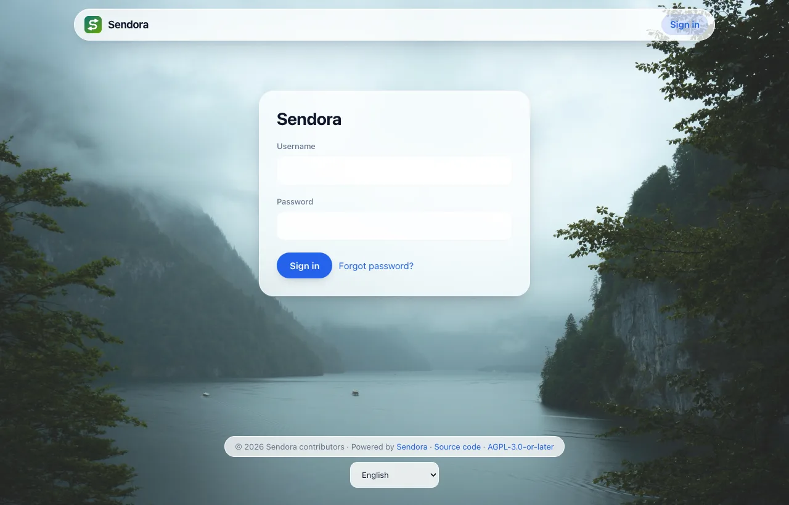
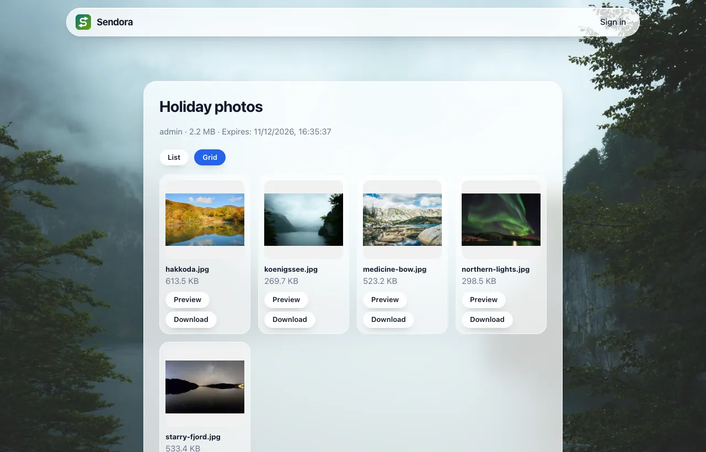
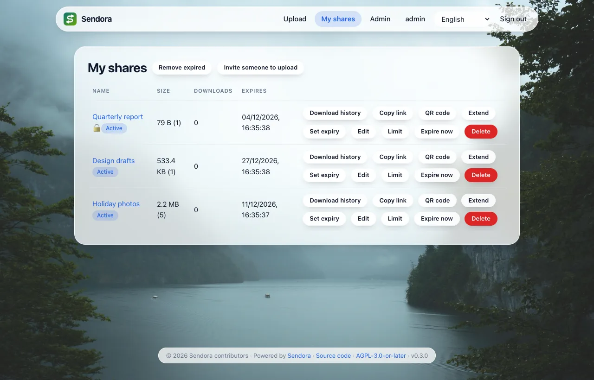
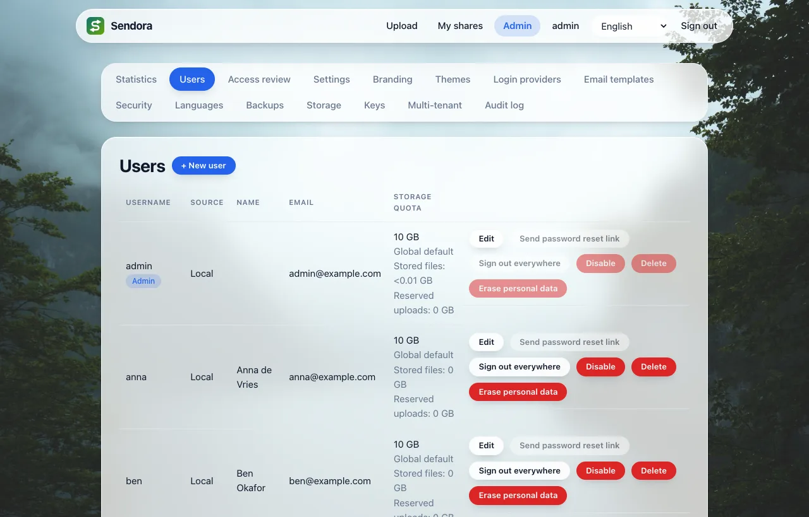
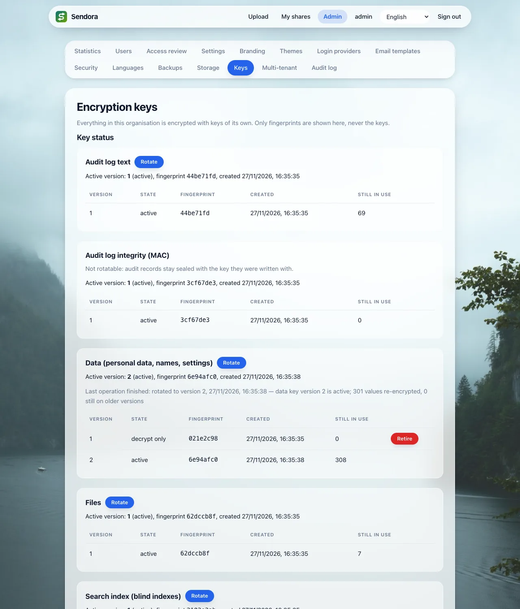
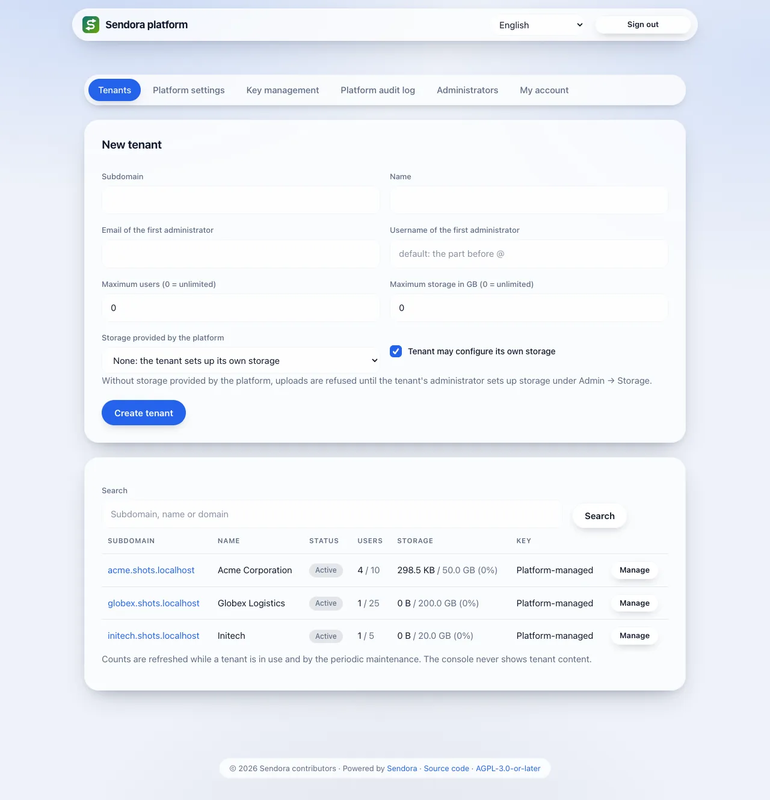

# Sendora

Sendora is a free and open source (AGPL-3.0-or-later), self-hosted file-sharing application with a Go backend (chi and SQLCipher-encrypted SQLite) and a Vue 3 frontend embedded in one executable.

This is an implementation under development, not a claim of a full penetration test or production readiness. Validate external integrations and your deployment before exposing a public service.

## About this project (please read)

Sendora is **vibe coded**: almost all of the code, tests and documentation were written by an AI coding assistant ([Claude Code](https://claude.com/claude-code)) in conversation with the maintainer, who is **not a software developer**. It started because the maintainer missed features in the existing self-hosted file-sharing tools and wanted to see whether they could be built this way.

What that means for you:

- The code has automated tests (Go and Node) and the maintainer checked the behaviour by hand, but **no professional developer or security specialist has reviewed it**, and there has been **no external penetration test**. Treat it accordingly, especially before exposing it to the internet or putting sensitive data in it.
- Some parts, such as passkeys (WebAuthn), single sign-on and the database encryption handling, are security-sensitive. They are tested against software test setups and have not been verified in every real-world environment (see [limitations](https://github.com/sendora-app/sendora/wiki/Security-Notes)).
- Design decisions follow what the assistant and the maintainer found sensible; you may disagree. Reviews, bug reports and pull requests from experienced developers are very welcome (see [CONTRIBUTING.md](CONTRIBUTING.md)); report vulnerabilities privately as described in [SECURITY.md](SECURITY.md).
- It is provided under the GNU AGPL-3.0-or-later **without warranty**.

## Features

- File and folder uploads through a custom resumable, chunked API.
- Readable share links (words and number blocks), with expiry that can be changed later, optional or required passwords with an administrator-defined policy, download limits, individual-file downloads, and ZIP downloads for multi-file shares.
- Editing existing shares (name, description, password, download limit), QR codes for share and invitation links, in-browser preview of images, video and audio, and a list or grid view on the share page.
- Reverse shares: authenticated users invite guests to upload by email or through an open link with a maximum number of uploads, without creating ordinary accounts.
- Local accounts, administrator-managed users, public registration with email verification, password reset, and profile preferences.
- OpenID Connect, Google, GitHub, and single-tenant Microsoft Entra ID login.
- Editable email subjects and bodies, download-start notifications, owner download history, statistics, and encrypted database backups.
- SQLCipher 4.20.0 database encryption with an external key, and encrypted share files (AES-256-GCM, no extra pass at upload time), a configurable default storage quota (10 GB for new installations) with per-user overrides in decimal GB, and local-password account lockout.
- Always-on, tamper-evident audit log (hash chain, 90 days by default, optional IP addresses) with a read-only auditor role, CSV/JSONL export and an offline `sendora-db audit-verify` check, and an optional external-login-only mode with lockout protection.
- Branding uploads (logo, favicon, backgrounds) that can each be deleted again, plus a choice of five bundled CC0 background photos (and an illustration), or no background at all, bundled/custom themes, and English, Dutch, German, French, and Spanish menus with per-account preferences.
- SHA-256 upload checks and server-prepared download snapshots with browser-side verification.
- Pluggable storage for share files (0.2.0): the local data directory (default), S3-compatible services, Azure Blob Storage or Google Cloud Storage. Files are encrypted before they leave the server; a background job migrates existing files, and database backups can be copied to the bucket. See [object storage](docs/STORAGE.md).
- Optional multi-tenancy (0.2.0): one process serves many organisations on their own subdomains or custom domains, each with its own encrypted database, keys, users, settings and storage, managed from a platform console. A single-tenant installation can be converted from the admin screen. See [multi-tenant mode](docs/MULTI-TENANT.md).
- Optional multi-factor authentication for local accounts: authenticator-app codes (TOTP) with one-time recovery codes, and passkeys or security keys (WebAuthn), set globally and overridable per user.

## What's new in 0.3

- **Three flavours from one binary and one image:** single-tenant and multi-tenant (SQLite, the main path) and **Cluster** (PostgreSQL 18 on CloudNativePG that you supply, several replicas, **preview**). See [Choosing a flavour](docs/CHOOSING-A-FLAVOUR.md) and the [capability matrix](docs/CAPABILITIES.md).
- **Column encryption in every flavour:** per-tenant keys, blind indexes for lookups, an authenticated key log, file content under the tenant's own keys. See [Encryption](docs/ENCRYPTION.md).
- **Key rotation by tenant administrators** (API and `sendora-db`), and in Cluster an optional **tenant-managed key** that the operator cannot use.
- **Cluster flavour:** separate `web` and `controller` roles, the master key only in the controller, tenants provisioned in their own PostgreSQL databases. See the [Cluster quickstart](docs/cluster/QUICKSTART.md).
- **Breaking for 0.2 databases:** they are refused until `sendora-db upgrade-encryption` has converted them; Cluster starts fresh. See the [upgrade notes](docs/CHOOSING-A-FLAVOUR.md#upgrading-from-02-to-03) and the [changelog](CHANGELOG.md).

## Screenshots

| | |
|---|---|
|  |  |
|  |  |
|  |  |

More in the [screenshot gallery](docs/SCREENSHOTS.md).

## Documentation

The complete documentation is in the **[wiki](https://github.com/sendora-app/sendora/wiki)**.

| Get started | Run and administer | Develop |
|---|---|---|
| [Quick start: Docker](docs/quickstart-docker.md) | [Configuration](https://github.com/sendora-app/sendora/wiki/Configuration) | [Development setup](https://github.com/sendora-app/sendora/wiki/Development-Setup) |
| [Quick start: Kubernetes](docs/quickstart-kubernetes.md) | [Hardening guide](https://github.com/sendora-app/sendora/wiki/Hardening-Guide) | [Architecture](https://github.com/sendora-app/sendora/wiki/Architecture) |
| [Docker Compose files](deploy/compose/README.md) | [Accounts and authentication](https://github.com/sendora-app/sendora/wiki/Accounts-and-Authentication) | [Code layout](https://github.com/sendora-app/sendora/wiki/Code-Layout) |
| [Docker deployment](https://github.com/sendora-app/sendora/wiki/Docker-Deployment) | [Sharing and transfers](https://github.com/sendora-app/sendora/wiki/Sharing-and-Transfers) | [Testing](https://github.com/sendora-app/sendora/wiki/Testing) |
| [Kubernetes deployment](https://github.com/sendora-app/sendora/wiki/Kubernetes-Deployment) | [Email and notifications](https://github.com/sendora-app/sendora/wiki/Email-and-Notifications) | [CI and releases](https://github.com/sendora-app/sendora/wiki/CI-and-Releases) |
| [Build from source](https://github.com/sendora-app/sendora/wiki/Installation-From-Source) | [Upgrades and backups](https://github.com/sendora-app/sendora/wiki/Upgrades-and-Backups) | [How to extend](https://github.com/sendora-app/sendora/wiki/How-To-Extend) |
| [Choosing a flavour](docs/CHOOSING-A-FLAVOUR.md) · [Cluster quickstart](docs/cluster/QUICKSTART.md) · [Helm chart](docs/helm.md) · [Encryption](docs/ENCRYPTION.md) | | |
| [Settings table](docs/configuration.md) · [Storage backends](https://github.com/sendora-app/sendora/wiki/Storage-Backends) · [Multi-tenant](https://github.com/sendora-app/sendora/wiki/Multi-Tenant) | [Troubleshooting](https://github.com/sendora-app/sendora/wiki/Troubleshooting) · [Security notes](https://github.com/sendora-app/sendora/wiki/Security-Notes) | [Translations](https://github.com/sendora-app/sendora/wiki/Translations) |

## For auditors

Sendora has **not** been independently audited or penetration tested. The documents below describe what the code does and what remains the operator's responsibility:

- [Compliance and audit documentation](docs/compliance/README.md): [security whitepaper](docs/compliance/SECURITY-WHITEPAPER.md), [shared responsibility matrix](docs/compliance/SHARED-RESPONSIBILITY.md) (ISO/IEC 27001, SOC 2), [data flows](docs/compliance/DATA-FLOW.md), [personal data](docs/compliance/PERSONAL-DATA.md), [audit events](docs/compliance/AUDIT-EVENTS.md), [vulnerability and dependency management](docs/compliance/VULNERABILITY-AND-DEPENDENCY-MANAGEMENT.md)
- [Threat model](docs/THREAT-MODEL.md) and [file format specification](docs/FILE-FORMAT.md)
- [Object storage](docs/STORAGE.md): S3-compatible, Azure Blob and Google Cloud Storage backends (files encrypted before upload), migration
- [Multi-tenant mode](docs/MULTI-TENANT.md): key derivation, routing, platform console, tenant isolation and the SSRF guard
- [Encryption](docs/ENCRYPTION.md): layers, key hierarchy, rotation, tenant-managed keys, limits and what each compromise exposes
- [Security policy](SECURITY.md), including how to verify release images

## Bundled background photos

The five background photographs in `web/src/assets/backgrounds/` come from Wikimedia Commons, where their uploaders declare them CC0 (public-domain dedication); sources, authors, licence labels and the provenance checks (including the Unsplash 2017-06-05 licence cut-off) are listed in `web/src/assets/backgrounds/CREDITS.md`. They were resized and recompressed and metadata was removed. Verify the licence information yourself before redistributing. The administrator chooses one of them, the original illustration, or no background under Admin → Branding; uploaded images always take precedence. The default is "Misty lake".

## License

Sendora is free software under the **GNU Affero General Public License, version 3 or later** (`AGPL-3.0-or-later`, see [LICENSE](LICENSE) and [NOTICE](NOTICE)), with two additional terms under section 7 of that license ([LICENSE-ADDITIONAL-TERMS.md](LICENSE-ADDITIONAL-TERMS.md)):

- the visible **"Powered by Sendora"** attribution, linking to the project, must stay in the user interface (footer or an equivalent place);
- the license grants no rights to the Sendora name and logo beyond that; see the [trademark policy](TRADEMARKS.md) (forks use their own name).

In short: you may use, study, modify and share Sendora, also commercially. If you distribute it, or let people use a modified version over a network, you must offer them the corresponding source code under the same license. Every page links to the source of the running version ("Source code" in the footer); forks set `SENDORA_SOURCE_URL` (or the `SOURCE_URL` build argument) to their own repository (see [configuration](docs/configuration.md)). The software is provided without warranty. Third-party dependencies retain their respective licenses.

**Earlier releases:** versions up to and including **0.2.0** were released under the MIT License and remain available under it. The AGPL applies from **0.2.1** on.

## Project

- [Security policy](SECURITY.md) and how to report a vulnerability
- [Contributing](CONTRIBUTING.md) (DCO sign-off, no CLA)
- [Trademark policy](TRADEMARKS.md)
- [Changelog](CHANGELOG.md) and known limitations
- [Third-party notices](THIRD_PARTY_NOTICES.md)
- [Example translations](custom-translations/README.md)
