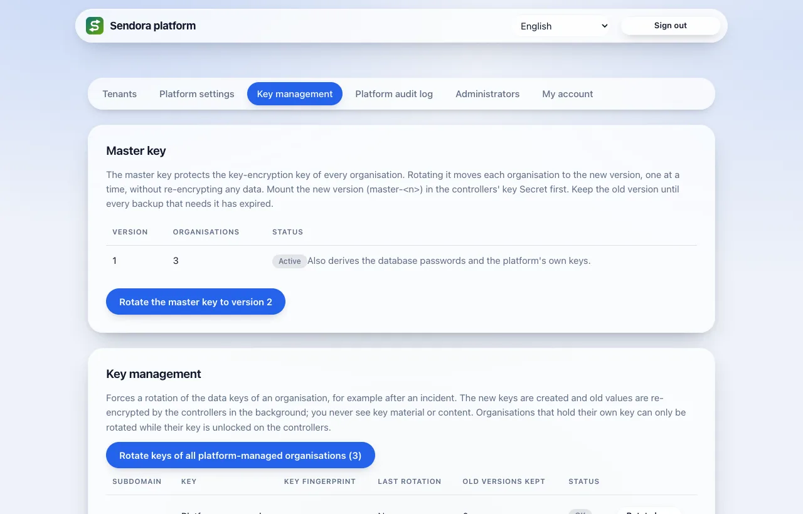
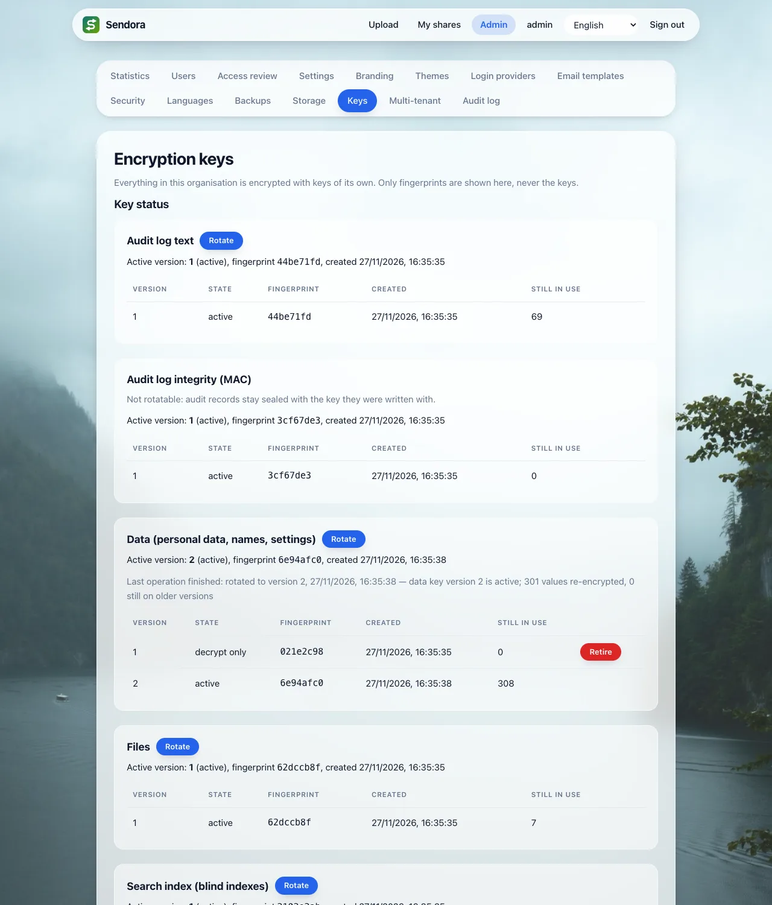

# Encryption in Sendora

[Back to the documentation index](README.md)

What is encrypted, with which keys, who can rotate what, and what encryption does **not** protect against.
For operators and tenant administrators. The file format is in [FILE-FORMAT.md](FILE-FORMAT.md); the threat model is in [THREAT-MODEL.md](THREAT-MODEL.md).
Sendora has not been reviewed by an independent security party. It is not end-to-end encrypted: whoever
controls the running server and its keys can read the data.

## 1. Layers

| Layer | Single / multi-tenant | Cluster | Protects against |
|---|---|---|---|
| TLS in front of the application | You provide it (reverse proxy or ingress) | You provide it; the key endpoint on the controller uses TLS 1.3 | Network sniffing |
| Whole-database encryption | SQLCipher, key from `SENDORA_DB_KEY_FILE` (per tenant keys are derived from it) | None: PostgreSQL has no transparent encryption. Use encrypted volumes and encrypted backups | A copy of the database file or the disk |
| **Column encryption** (AES-256-GCM, per tenant keys) | Yes, inside the SQLCipher file | Yes, the only database-level protection | A reader of the decrypted database: plaintext dump, DBA, backup reader, replication reader |
| **File encryption** (AES-256-GCM per file, see [FILE-FORMAT.md](FILE-FORMAT.md)) | Yes | Yes | A reader of the volume or bucket |

## 2. What is encrypted

Column encryption seals each value on its own, bound to its table, column and row, so a value copied to
another row or changed by one bit is refused. Categories:

- **Users:** user names, e-mail addresses, password hashes and password history, TOTP secrets.
- **Shares:** names, descriptions, password hashes, link IDs, invitation recipient names, e-mail addresses and messages.
- **Files:** file names, paths, content hashes (`files.name`, `full_path`, `sha256`, and the upload equivalents) and the **file content**.
- **Settings:** every setting value, including secrets such as SMTP passwords; storage credentials; sign-in provider client secrets.
- **Audit log:** actor name, target and detail, sealed under the `audit-enc` key (not `data`). The hash chain is computed over the plaintext, and verification opens the columns first.
- **Sessions:** user agent and IP address of refresh tokens.
- **Platform database, Cluster:** the platform administrators' TOTP secrets and the legacy root of imported tenants.

Searching by user name, e-mail or link ID uses **blind indexes**: a keyed hash (HMAC-SHA256 under the
tenant's `index` key, 16 bytes) of the normalised value. Matching is Unicode case-insensitive. A blind
index leaks equality and frequency inside one tenant, not across tenants.

**Stays in plaintext** (the database administrator sees it): IDs and foreign keys, timestamps, statuses,
quotas and counters, tenant slugs and custom domains (public anyway), `files.size` (it reveals the exact
plaintext size), the audit log's role, action, category and outcome, and recovery-code hashes
(unkeyed SHA-256 of 80-bit codes). Branding images are plain by design. Upload staging parts
(`uploads/*.part`) are plaintext on the volume until the upload completes.

The platform database of the SQLite multi-tenant flavour encrypts per column only its secrets: the
platform administrators' TOTP secrets (active and pending), the database root keys of tenants imported from a
single-tenant installation, and every platform setting value (including the SMTP password). Its other columns
(tenant names, slugs, domains, quotas, the administrators' usernames, e-mail addresses and password hashes,
sessions) are protected by SQLCipher and the key file only.

## 3. Key hierarchy

```
KEK (key encryption key)
 ├── wraps the data keys of each tenant (AES-256-GCM)
 └── MACs the tenant's control log
Per tenant, per purpose, versioned data keys (DEKs), 32 random bytes each, stored only wrapped:
 data       column encryption (a subkey per table.column is derived from it)
 index      blind indexes
 secrets    settings secrets (reserved: nothing is sealed under it yet)
 audit-enc  the audit log's actor name, target and detail (a subkey per table.column; new records use the active version)
 files      stored share files (the file master; filecrypt derives each file's key)
 audit-mac  the audit chain's HMAC key, fixed at version 1
```

- **Control log.** Each tenant database has an authenticated, hash-chained log of every key event
  (created, wrapped, confirmed, activated, retired, KEK hand-over). It is verified when a database or tenant
  is opened (SQLite flavours: at every start; Cluster: by the replicas and the controller). A log that does
  not verify, or a key that does not match, stops the database from opening ("fail closed").
- **Key states:** created, confirmed, active, decrypt-only, retired. Rotation makes a new version active and
  the old one decrypt-only; retiring is allowed only when no value or file still uses it.
- **Where the KEK comes from.**
  - *SQLite flavours:* derived (HKDF) from the key that opens the database file. One key file protects everything.
  - *Cluster, platform-managed tenant (default):* derived from a version of the master key (`SENDORA_DB_KEY_FILE`, a key file or a directory of `master-<n>` files), which exists only in `controller` pods; the tenant's record names the version.
  - *Cluster, tenant-managed tenant:* a 32-byte key the tenant uploads. The platform keeps only its fingerprint; see section 6.
- Separate KEK files with their own rotation are **not built**.

## 4. Who can do what

| Action | Who | How |
|---|---|---|
| Rotate `data`, `index`, `secrets`, `audit-enc`, `files` | Tenant administrator (step-up required, audited in the tenant log) | **Admin → Keys**, the API below, or offline `sendora-db rotate-key` |
| Retire an old version | Tenant administrator | **Admin → Keys**, API, or `sendora-db retire-key` |
| Convert files written by 0.2 | Tenant administrator | **Admin → Keys** (Convert legacy files), `POST /api/admin/keys/reencrypt-files` or `sendora-db files-reencrypt` |
| Switch to, replace or release a tenant-managed KEK | Tenant administrator, Cluster only | **Admin → Keys** (Tenant key), or `/api/admin/kek*` |
| Force a rotation of `data`, `index`, `secrets`, `files` of one or all platform-managed tenants | Platform administrator (step-up, written reason, platform audit log, `SENDORA_KEY_OPS_PER_HOUR`) | Platform console, **Key management** (multi-tenant flavours; capability `operator_key_rotation`) |
| Rotate the **master key** (and with it the platform KEK of every tenant) | Platform administrator, Cluster only | Platform console, **Key management → Master key** (capability `master_key_rotation`); see "Rotating the master key" below |
| Rotate `audit-mac` | Nobody | Refused: the chain is authenticated under it for its whole life |
| Read key material | Nobody through the product | The APIs return versions, states and fingerprints, never keys |

A platform administrator sees a tenant's key mode, KEK fingerprint, last rotation, how many old versions are
kept and whether a key job runs, never key material or content. The operator can **force** a rotation (after an
incident) for one tenant or for all platform-managed tenants: the request is the same key job a tenant
administrator creates, executed by the controller, with `platform:<admin>` as actor and the written reason in
both audit logs. Tenant-managed tenants are skipped in a bulk request and reported; a single request for one is
accepted only while its key is unlocked on every controller, otherwise the answer is `locked`.

### Rotating the master key (Cluster)



The master key (`SENDORA_DB_KEY_FILE`) derives the platform KEK of every tenant. It can now be versioned:
point `SENDORA_DB_KEY_FILE` at a **directory** with one file `master-<n>` per version (a single file is
version 1, as before). To rotate: (1) add `master-<n+1>` (32 random bytes) to the controllers' Secret and wait
until every controller pod sees it; (2) **Key management → Master key → Rotate** (step-up and a reason); (3) the
controller leader moves the tenants **one at a time**. A platform-managed tenant gets a second wrap of each data
key under the new KEK, the log is attested under the new KEK, the record switches to the new version and the old
wraps are destroyed; no data is re-encrypted and the data keys do not change. A tenant-managed tenant keeps its
own wraps; only the log's MAC moves. A controller crash or a change of leader is resumed by the next pass. (4)
When no tenant uses an old version it can be **retired** in the same screen; only then remove its file.
**What is not rotated:** the platform's own material (platform database password and key, rate-limit key) and
the tenants' database role passwords stay derived from version 1, so version 1 can never be retired. **Backups:**
a backup needs the master version it was taken under (and a tenant-managed tenant its own key); keep old
versions until every backup made before the rotation has expired.

The **Admin → Keys** screen (tenant administrators; capability `key_management_ui`) shows, per purpose, the
active version, state, short fingerprint, creation time, how many values or files are still on older versions
and the progress of a running job. It offers Rotate (with confirmation and step-up), Retire (only for a
decrypt-only version that no value or file uses), Convert legacy files, and in the Cluster flavour the *Tenant
key* section: use your own key (generated in the browser with `crypto.getRandomValues`, shown once, with copy and
download; or pasted), replace it, or return to platform-managed. The key is held in page memory only, never in
browser storage or the URL, and is wiped when the dialog closes. The unlock page for a locked tenant is a separate
public page. In the SQLite flavours the Tenant key section explains that it is Cluster-only. The platform console
lists each tenant's key mode and KEK fingerprint.

### Rotating keys



Administrators only. `rotate`, `retire` and `reencrypt-files` need a fresh step-up confirmation.

| Endpoint | Purpose |
|---|---|
| `GET /api/admin/keys` | Per purpose: versions, states, fingerprints, the number of values or files still on each version, recent jobs, and `legacy_files`. Never key material |
| `POST /api/admin/keys/rotate` `{"purpose": "data"}` | Create the next version and start the re-encryption job. Purposes: `data`, `files`, `index`, `secrets`, `audit-enc` |
| `POST /api/admin/keys/retire` `{"purpose": "data", "version": 1}` | Retire a decrypt-only version that nothing uses any more |
| `POST /api/admin/keys/reencrypt-files` | Rewrite stored files that are not under the active `files` key, including files from 0.2 |

How a rotation runs: the request is a row in the tenant's own database, and the process that may write the
control log runs it (the SQLite process itself, or the Cluster controller leader). Values are re-encrypted
in small batches with a compare-and-swap, so a concurrent write is never lost. Rotating `index` rebuilds the
blind indexes. Rotating `files` rewrites each file to a new object and removes the old one after a read-back
check. Audit-log fields are append-only and are never rewritten (the tamper guard forbids it, and no job re-seals
them): they are sealed under `audit-enc` and keep the version they were written under. The `data` job does not touch
them, so a `data` version can be retired as soon as no other value uses it. Rotating `audit-enc` only makes new
records use the new version; an old `audit-enc` version cannot be retired until retention has purged the records
sealed under it. Databases written by earlier 0.3 test builds sealed audit text under `data`; there is no
compatibility path, so such audit rows fail closed (start a new database).

### Offline commands

Run with the application stopped, after a backup. `sendora-db` is the same binary as `sendora db`.
For a multi-tenant installation add `-tenant <id>` (the tenant key is derived from the master key).

| Command | What it does |
|---|---|
| `sendora-db upgrade-encryption -source <db> [-data-dir <dir>] -key-file <key>` | Encrypt a 0.2 database in place after a safety copy ([upgrade notes](CHOOSING-A-FLAVOUR.md#upgrading-from-02-to-03)) |
| `sendora-db upgrade-encryption -platform -data-dir <dir> -key-file <master key>` | Encrypt the platform database of a 0.2 multi-tenant installation in place after a safety copy |
| `sendora-db rotate-key -source <db> -data-dir <dir> -key-file <key> -purpose <p>` | Create the next version of a purpose and run the re-encryption to completion (safety copy first) |
| `sendora-db retire-key ... -purpose <p> -version <n>` | Retire a decrypt-only version |
| `sendora-db files-reencrypt ...` | Re-encrypt stored files under the active `files` key (back up the data directory too) |
| `sendora-db shamir-split -key-file <key> [-threshold 3 -shares 5]` | Print Shamir shares of a 32-byte key file for offline custody |
| `sendora-db shamir-combine -destination <new file> -shares a,b,c` | Rebuild a key file from enough shares |
| `sendora-db kek-generate [-shares 3-of-5]` | Cluster: print a new tenant key (base64) and its fingerprint, optionally with Shamir shares |
| `sendora-db tenant-unlock -tenant <id> (-kek-file <f> \| -shares a,b,c)` | Cluster: present a tenant's key to every controller; run it in a web pod, which already has `SENDORA_KEY_URL`, `SENDORA_KEY_CA` and `SENDORA_KEY_TOKEN_FILE` |

## 5. Re-keying copies

Anything that copies a database under another key re-keys the column layer too (tenant import, restoring a
backup from another installation, a database key change): values are opened with the source's keys and
sealed again under new ones. The `files`, `audit-mac` and `audit-enc` keys are carried over, so stored files stay
readable and the audit chain stays verifiable. A same-key backup keeps its keys.

## 6. Tenant-managed KEK (Cluster only)

By default the platform holds the KEK, so the operator can restore a tenant without the tenant's help. A
tenant administrator can instead upload its own KEK. Then the platform no longer
holds a usable copy: the operator's wraps of the data keys are destroyed at the switch, and the operator
holds nothing that decrypts the tenant's columns, files or audit MAC key.

| Endpoint (tenant administrators, step-up, at most 6 operations per hour, not while a key rotation runs) | Purpose |
|---|---|
| `GET /api/admin/kek` | Mode (`platform` or `tenant`), fingerprint, locked state, controllers unlocked |
| `POST /api/admin/kek/upload` `{"kek": "<base64>", "confirm": "<tenant slug>"}` | Switch to a tenant-managed key |
| `POST /api/admin/kek/replace` `{"old_kek": "...", "new_kek": "..."}` | Rewrap under a new key (no data re-encryption) |
| `POST /api/admin/kek/release` `{"kek": "..."}` | Return to platform-managed |
| `POST /api/unlock` `{"kek": "..."}` (public, rate limited, audited; `GET` shows the fingerprint) | Present the key to a locked tenant |

The key is 32 random bytes as base64; weak input is refused. Make one with `sendora-db kek-generate`.

Consequences you must plan for:

- **Losing the key loses the data.** Nobody can recover it, the operator and backups included (crypto-shredding).
  Keep the key, or its Shamir shares (3 of 5), in places the tenant controls, and note the fingerprint.
- **Restarts lock the tenant.** The key lives only in controller memory. After a controller restart (rollout,
  node loss) every tenant-managed tenant is `locked` on that controller: requests answer HTTP 423
  (`{"code":"tenant_locked"}`; pages show an unlock page) until the tenant, or the operator with the
  tenant's key, unlocks it. Platform-managed tenants are not affected. How long a web pod keeps serving
  after a controller reports the lock is bounded by `SENDORA_KEY_TTL_SECONDS` (default 600).
- **Switching or replacing the key takes effect on every replica at once.** A web pod whose cached keys
  lack the tenant's new key fetches them again from a controller as soon as it notices (at most once every
  5 seconds per tenant), instead of failing until its key cache expires.
- **Restore.** The operator restores the encrypted database; it comes back locked. See
  [cluster/TENANT-KEY-RESTORE.md](cluster/TENANT-KEY-RESTORE.md).

## 7. Honest limits

- **SQLite flavours:** the KEK is derived from the database key. Column encryption protects against a decrypted
  copy, a plaintext dump or a reader of the data without the key, but **not against someone who holds the key
  file**. Protect that file and keep a separate recovery copy (`shamir-split` helps).
- **Cluster:** whoever controls the `controller` pods, can read the master key Secret (RBAC, etcd) or exec into a
  controller can read every platform-managed tenant. A compromised `web` pod yields the derived keys of the
  tenants it served within the key cache window (and can ask the key endpoint for other active tenants while it
  runs; rate limit, audit log and the pod's short-lived token are the brakes), never the master key. For an
  unlocked tenant-managed tenant, the web pod holds the wrapping key derived from the tenant's key.
- **A running controller** holds the wrapping key of each unlocked tenant-managed tenant in memory.
- **No external KMS or HSM.** The KEK is a key file (or the tenant's key). Nothing keeps it out of the cluster.
- **No journal or WORM anchors.** The control log and the audit chain detect tampering that leaves the chain
  inconsistent, but an attacker who can rewrite the whole database and holds the keys could rebuild a
  consistent chain. Independent anchoring is not planned; a future journal would hold only encrypted content.
- **Master key rotation covers the tenant KEKs and the log MACs, not the database passwords:** the platform's own
  material and the tenants' database role passwords stay derived from master key version 1, so a master key
  compromise also needs those changed by other means (they are only useful with network access to PostgreSQL).
- **Metadata is visible** to the database administrator: counts, exact file sizes, timestamps, statuses, quotas,
  slugs and blind indexes.
- **Backups of earlier key versions** stay decryptable with the old wrapped keys; retiring a version does not
  reach into backups.
- **PostgreSQL superuser access** is break-glass only (`kubectl exec` into an instance); network login for
  superusers is off. Encrypted volumes and backups remain the operator's job.

## 8. What each compromise exposes

| Compromised | SQLite flavours | Cluster |
|---|---|---|
| Database file or volume copy, no key | Ciphertext (SQLCipher, then column encryption) | n/a (ciphertext columns, metadata in plaintext) |
| Database administrator or backup reader (PostgreSQL) | n/a | Ciphertext, wrapped keys, blind indexes, metadata. No plaintext content |
| Key file (`SENDORA_DB_KEY_FILE`) | Everything, all tenants (every key derives from it) | Every platform-managed tenant. Tenant-managed tenants stay sealed without their own key |
| `web` pod (remote code execution) | n/a (one process) | Derived keys of the tenants it served, current data in those tenants while it runs; not the master key, not provisioner credentials |
| `controller` pod or the master key Secret | n/a | All platform-managed tenants; for unlocked tenant-managed tenants the wrapping key in memory while it runs |
| PostgreSQL provisioner credentials | n/a | Ownership of every tenant database, still ciphertext without keys |
| Tenant administrator | Own tenant's data and its key operations | Same, plus its own KEK |
| Platform administrator | Counts and tenant metadata, not content | Same, plus key mode and fingerprint |
| A tenant's KEK (tenant-managed) | n/a | That tenant's keys, but only together with its database or a backup |
| Loss of a tenant's KEK (tenant-managed) | n/a | That tenant's data is gone, backups included |
| Loss of the key file with no copy | Database unrecoverable | Every platform-managed tenant unrecoverable |
