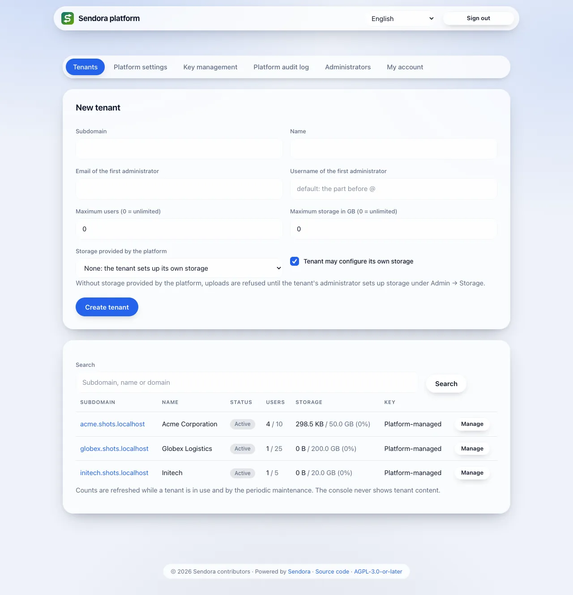
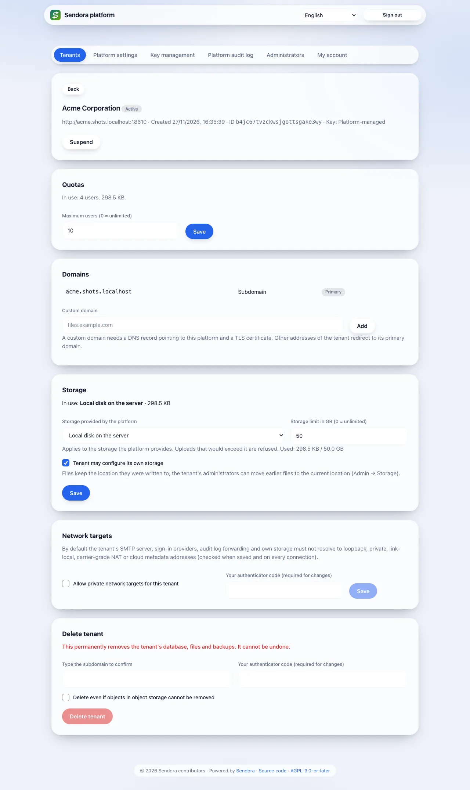
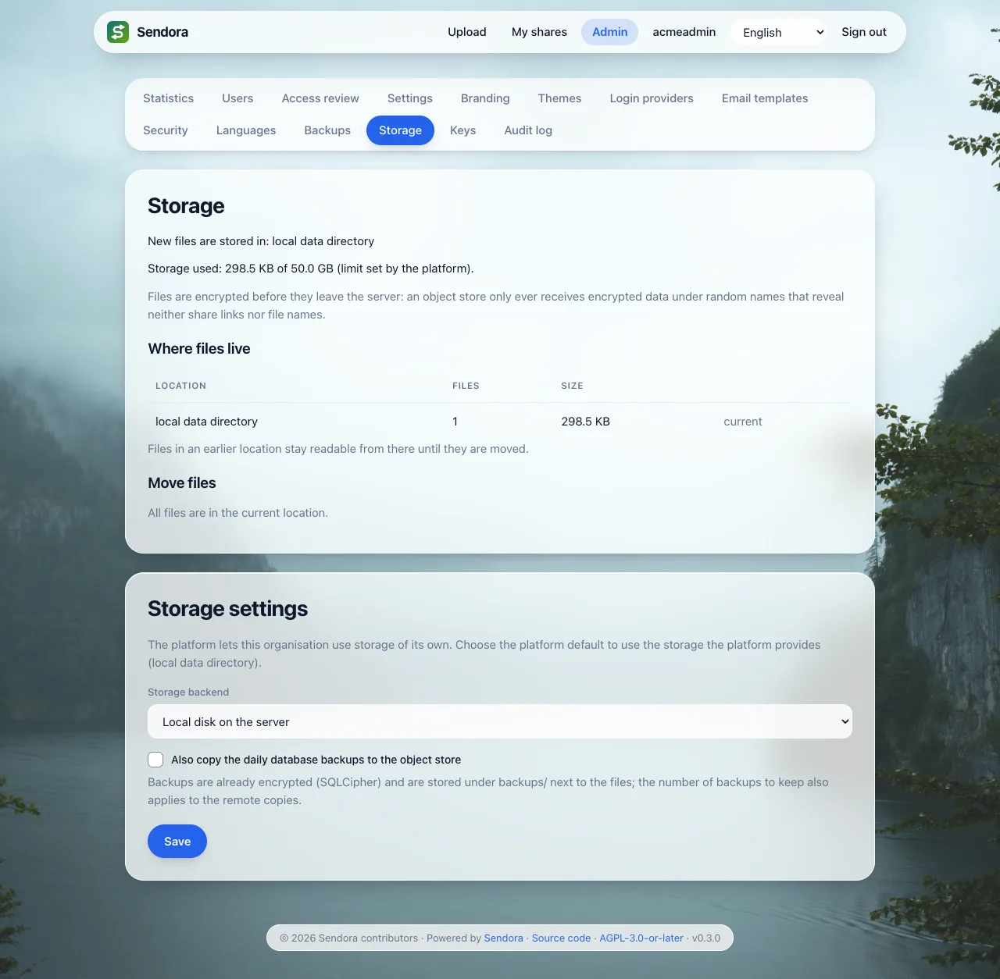

# Multi-tenancy

One Sendora process can serve many organisations ("tenants"), each on its own
subdomain or custom domain, with its own users, settings, branding, SMTP server,
sign-in providers, shares, audit log and backups. Multi-tenancy is **optional**:
without `SENDORA_MULTI_TENANT=true` Sendora runs exactly as a single-tenant
installation and nothing in this document applies.

[Back to the documentation index](README.md)

## Overview

This section explains multi-tenancy in plain language for administrators and decision makers. The sections after it give the technical details.

### Platform and organisations

A **platform** is one Sendora installation that serves several **organisations** (in the technical text also called *tenants*). Each organisation gets its own Sendora: its own web address, users, shares, settings, look and feel, and audit log. To the people of an organisation it looks like a Sendora of their own. They do not see that other organisations share the same server.

| Role | Who it is | What they do |
|---|---|---|
| **Platform administrator** | The party that runs the installation (for example an IT department, hosting company or MSP) | Creates and removes organisations, sets quotas and storage limits, verifies custom domains, chooses platform-wide settings. Works in the **platform console** on `admin.<base domain>`. |
| **Organisation administrator** | An administrator within one organisation | Manages that organisation's users, settings, branding, mail server, sign-in providers and storage, exactly like the administrator of a single installation. Sees only their own organisation. |
| **Users** | The people of one organisation | Upload, share and receive files as usual. They only ever see their own organisation. |

### How a visitor reaches the right organisation

Every organisation has its own host name. The platform looks only at the host name in the address bar to decide where a request goes:

| Address | Goes to |
|---|---|
| `acme.sendora.example.com` | the organisation with subdomain `acme` |
| `files.acme.com` (a verified custom domain) | the same organisation |
| `admin.sendora.example.com` | the platform console |
| any other address | a plain "page not found", the same for every unknown address, so nobody can probe which organisations exist |

```
  browser                     one Sendora process
 ─────────                   ─────────────────────────────────────────────────────
  acme.sendora.example.com ─┐
  files.acme.com ───────────┼──► router ──► Acme      ──► own database + own storage
  globex.sendora.example.com┼──► (by host) ──► Globex  ──► own database + own storage
  admin.sendora.example.com ┘            └──► platform console ──► platform database
                                                (organisations, quotas, domains;
                                                 counts only, no content)
```

### What is kept separate

| Kept separate per organisation | What that means |
|---|---|
| Database | Each organisation has its own encrypted database file. |
| Encryption keys | Each database has its own key, derived from the platform's master key. A link, sign-in session or file of one organisation does not work in another. |
| Files | Stored apart and encrypted with the organisation's own key, also when several organisations share one bucket. |
| Audit log | Each organisation has its own tamper-evident audit log; the platform has a separate one for console actions. |
| Settings and look | Branding, themes, email texts, policies, quotas and languages. |
| Sign-in | Each organisation has its own accounts, two-step verification and sign-in providers (for example its own Microsoft Entra ID). |
| Mail | Its own mail server, or the platform's mail server as a fallback. |

### What the platform administrator can and cannot see

| Can see and do | Cannot see or do |
|---|---|
| The list of organisations, their status and web addresses | Users, user names or email addresses inside an organisation |
| Counts: number of users, bytes stored | Shares, file names or file contents |
| Quotas, storage limits, custom domains | The organisation's audit records |
| Which kind of storage an organisation uses ("Own storage (Azure)") and how much | The organisation's own bucket, account names or keys; it can neither change nor test them |
| Suspend, resume or delete an organisation | Sign in as an organisation's user |
| Key management: each organisation's key mode, KEK fingerprint, last rotation and running key jobs; **force a rotation** of the data keys of one or all platform-managed organisations (step-up and a written reason); in the Cluster flavour rotate the master key | Key material of any kind, or the key of an organisation that holds its own |

Every console action is recorded in the platform audit log, and actions that affect an organisation also appear in that organisation's own audit log, so the organisation can see what the platform did. Note: whoever runs the server and holds the master key can technically decrypt everything with offline tools. Multi-tenancy separates organisations from each other and from the console, not from the operator of the server.

### Storage choices

A new organisation starts **without storage**: until storage is set up, nobody in it can upload. The platform decides what is allowed and offered; the organisation chooses.

| Option | Who provides it | Limit |
|---|---|---|
| **Own storage** (allowed by default) | The organisation connects its own S3-compatible, Azure Blob or Google Cloud Storage account under Admin → Storage | No platform limit; the organisation pays its own provider |
| **Platform bucket** (optional offer) | The platform's shared bucket, with a separate folder per organisation | A storage limit in GB, set per organisation in the console |
| **Local disk** (optional offer) | The server's own disk | The same storage limit in GB |

Files are always encrypted by Sendora before they are stored. With object storage, an upload takes a little longer before the share is ready (the file is encrypted and copied to the bucket first), and downloads are read back from the bucket, so large files or a far-away region are slower. The screens show this notice when remote storage is chosen.

### How to start

| Starting point | What to do |
|---|---|
| **A new platform** | Start Sendora with multi-tenant mode on and a base domain, create the first platform administrator with the setup code from the log, then create organisations in the console. |
| **An existing Sendora installation** | Use **Admin → Multi-tenant** (the conversion wizard). The installation becomes the first organisation; users, shares and links are kept. After *Restart now* the platform is live. If something goes wrong, the installation starts unchanged. |
| **An existing installation moving to a new environment** | Copy its data directory and key to the new platform and run `sendora-db tenant-import -from ...`. It becomes a new organisation next to the existing ones; the old installation is only read and can keep running until you switch DNS. |

### DNS and certificates

| Requirement | Why |
|---|---|
| A wildcard DNS record `*.sendora.example.com` pointing to the server or ingress | Every organisation and the console get their own subdomain |
| A wildcard TLS certificate for `*.sendora.example.com` (for example Let's Encrypt with a DNS-01 challenge) | HTTPS for all those subdomains |
| Per custom domain: a DNS record to the platform, a TXT verification record, and a certificate | Organisations can use their own address |

**Tip for local testing:** use the base domain `localhost:9090` (or another port). Browsers send every `*.localhost` name to your own computer, so `http://acme.localhost:9090` and `http://admin.localhost:9090` work without any DNS. When the server is not reached on port 80 or 443, enter that port in the base domain's port field; the wizard warns when the port does not match.

### Limits

| Limit | Meaning |
|---|---|
| One process | All organisations are served by one Sendora process on one server or pod. There is no clustering or failover; scale by giving the server more CPU and memory. |
| SQLite | Each organisation's database is a single file with one writer at a time; very busy organisations can slow others down. Quotas limit users and storage, not traffic. |
| One master key | Losing the master key means losing every organisation. Keep a protected copy off the server. |
| Certificates | Sendora does not issue certificates itself; your ingress or proxy does. |

## 1. Architecture

```
                  ┌───────────────────────── one sendora process ─────────────────────────┐
 klant1.example → │ TenantHost ──► *app.Server (klant1)  ──► tenants/<id1>/sendora.db + files │
 klant2.example → │  (routes by    *app.Server (klant2)  ──► tenants/<id2>/sendora.db + files │
 files.acme.nl  → │   Host)        … opened on demand, closed when idle (LRU)                 │
 admin.example  → │            ──► platform console ──► platform.db (tenants, admins, audit) │
 anything else  → │            ──► plain 404                                                  │
                  └────────────────────────────────────────────────────────────────────────┘
```

- **Platform database** `DATA_DIR/platform.db` (SQLCipher): tenants (random ID,
  subdomain, name, status, quotas, cached counts), custom domains with their DNS
  verification token, the per-tenant storage configuration (see §8), the
  platform administrators (bcrypt, TOTP required by default) and the platform audit log
  (the same tamper-evident HMAC chain as a tenant's audit log).
- **Tenant data** `DATA_DIR/tenants/<tenant id>/`: the tenant's own SQLCipher
  database `sendora.db` and `shares/`, `uploads/`, `backups/`, `branding/`,
  `backgrounds/` — exactly the layout of a single-tenant `DATA_DIR`. The
  directory name is the random tenant ID, never the subdomain.
- **One server per tenant**: every tenant is served by its own `*app.Server`
  with its own store. Nothing is shared between two tenant servers except the
  process, the embedded web build and the platform's routing table.
- **Lazy open, idle close**: a tenant is opened on its first request and closed
  after `tenant_idle_minutes` (default 15) without requests. At most
  `max_open_tenants` (default 50) are open; when the limit is reached the least
  recently used idle tenant is closed first (a request gets 503 + `Retry-After`
  only when every open tenant is busy). Concurrent first requests open a tenant
  once.
- **Background jobs** (expiry, clean-up, expiry mails, password expiry warnings,
  audit retention, the daily backup) run for every open tenant as in
  single-tenant mode. Every `tenant_maintenance_hours` (default 6) the platform
  also opens each idle tenant briefly so its jobs run, records its counts and
  closes it again. The daily backup is due by the age of the newest backup, not
  by uptime.

## 2. Key derivation

The master key is the 32-byte file named by `SENDORA_DB_KEY_FILE`. In
multi-tenant mode it is **never used directly** as a database key; every
database gets its own key, derived with HKDF-SHA256 (no salt) and a
domain-separated label as the info string:

| Key | Derivation |
| --- | --- |
| platform database | `HKDF-SHA256(master, info = "sendora/v1/platform-db")` |
| tenant database | `HKDF-SHA256(master, info = "sendora/v1/tenant-db/<tenant id>")` |

The tenant ID is 128 random bits (26 lowercase base32 characters). Inside a
tenant, the key that wraps the tenant's data keys is derived from the tenant's
own database key as in single-tenant mode (and is the tenant's own KEK in
tenant-managed mode). The keys that protect content are random
DEKs in the tenant's keyring: the share file master key
(`filecrypt.MasterKey(filesDEK)`), the audit chain's MAC key (`audit-mac` DEK)
and the column keys. Also random values stored in the tenant's
own database are the access-token signing secret and every HMAC key (refresh
tokens, reset and welcome links, MFA tickets, WebAuthn user handles, credential
versions). `JWT_SECRET` and `APP_URL` are ignored in multi-tenant mode (a shared
signing secret would let a token of one tenant verify in another).

Consequences:

- a token, cookie, refresh token, reset/welcome link, MFA ticket or share link
  of tenant A never verifies in tenant B: B has neither the row nor the key;
- a file of tenant A cannot be decrypted with tenant B's keys;
- copying a tenant's directory elsewhere does not give access without the
  master key and the tenant ID;
- losing the master key loses **all** tenants: keep a protected recovery copy.

## 3. Routing

The request host decides everything:

| Host | Goes to |
| --- | --- |
| `<slug>.<base domain>` | that tenant |
| a **verified** custom domain | that tenant |
| `admin.<base domain>` | the platform console |
| anything else (including the bare base domain and unknown subdomains) | plain `404 page not found`, identical for every unknown host, so hosts cannot be used to find tenants |

- `X-Forwarded-Host` is used only when the TCP peer is in
  `SENDORA_TRUSTED_PROXIES`; otherwise it is ignored. The ports in `Host` are
  ignored for routing.
- A **suspended** tenant answers `503` (a small page for browsers, JSON for the
  API) and is closed once its running requests finish.
- **One origin per tenant**: a tenant's public URL is its *primary* domain —
  `https://<slug>.<base domain>` by default, or a verified custom domain chosen
  as primary. Requests to the tenant's other hosts are redirected there (`308`
  for GET/HEAD, `421` for other methods), so cookies, passkeys (WebAuthn RP ID)
  and links always use one origin. Emails and links use this URL.
- Cookies are host-only (no `Domain` attribute): a tenant's cookies are never
  sent to another tenant or to the console, and the console's cookie never to a
  tenant.
- `/api/health` answers on every host (container health check, orchestrator
  probes).
- For local testing, `SENDORA_BASE_DOMAIN=localhost:9090` serves
  `http://klant1.localhost:9090` and `http://admin.localhost:9090` (browsers
  resolve `*.localhost` to the loopback address; `http` is only used for
  `localhost` base domains, otherwise URLs are `https`).

## 4. Configuration

| Variable | Purpose |
| --- | --- |
| `SENDORA_MULTI_TENANT` | `true` enables multi-tenant mode. |
| `SENDORA_BASE_DOMAIN` | Required. Host name of the platform, optionally with `:port` used only in generated URLs (e.g. `sendora.example.com`, `localhost:9090`). |
| `SENDORA_DB_INITIALIZE` | `true` once, to create `platform.db`. Tenant databases are created by the platform. |
| `SENDORA_PLATFORM_SETUP_CODE` | Optional fixed one-time code for creating the first platform administrator (otherwise generated and printed in the log). |
| `SENDORA_TENANT_IDLE_MINUTES`, `SENDORA_MAX_OPEN_TENANTS`, `SENDORA_TENANT_MAINTENANCE_HOURS`, `SENDORA_DEFAULT_MAX_USERS`, `SENDORA_DEFAULT_MAX_STORAGE_BYTES`, `SENDORA_PLATFORM_AUDIT_RETENTION_DAYS` | Platform settings (also editable in the console unless set here). |
| `SENDORA_PLATFORM_SMTP_HOST`, `_PORT`, `_USER`, `_PASSWORD` (or `_PASSWORD_FILE`), `_FROM`, `_TLS` | Default SMTP server for tenants that have no SMTP server of their own (welcome mails, resets, notifications). |
| `SENDORA_PLATFORM_STORAGE_*` | The platform default object storage (§8): the same fields as a single-tenant installation's `SENDORA_STORAGE_*` with `PLATFORM_` in front (`SENDORA_PLATFORM_STORAGE_BACKEND`, `SENDORA_PLATFORM_STORAGE_S3_BUCKET`, `SENDORA_PLATFORM_STORAGE_S3_SECRET_KEY_FILE`, ...). `SENDORA_STORAGE_*` is ignored in multi-tenant mode. |
| `SENDORA_NEW_TENANT_STORAGE_OFFER` | Storage the platform provides to new tenants: `none` (default; they set up their own), `platform` (the platform bucket; needs a platform default backend) or `local`. Preselected in the create-tenant form (§8). |
| `SENDORA_PLATFORM_MFA_REQUIRED` | `true` (default): platform administrators must use an authenticator app. `false`: password-only sign-in (§5). |

Every other `SENDORA_<SETTING>` variable keeps its meaning but applies to
**every** tenant and is read-only in each tenant's admin screen — use this for
platform-wide policy (for example `SENDORA_MFA_POLICY=required`). Leave per-tenant
choices (SMTP, branding, providers) to the tenants. `SENDORA_TRUSTED_PROXIES`,
`SENDORA_FORCE_LOCAL_LOGIN`, `SENDORA_DISABLE_IP_BANS` and
`SENDORA_DISABLE_ADMIN_IP_ALLOWLIST` apply to all tenants.

Safety switches: a single-tenant start refuses a `DATA_DIR` that contains
`platform.db`, and a multi-tenant start refuses a `DATA_DIR` that still contains
a single-tenant `sendora.db` (convert it first, §7).

## 5. The platform console



`https://admin.<base domain>` (served only on that host; the tenant hosts never
serve the console page or its API).

- **First administrator**: on first start the log shows
  `platform console setup code: XXXX-XXXX-XXXX`. Open the console, enter the
  code, choose a username and password (at least 12 characters, screened against
  common passwords), then enrol an authenticator app (TOTP). Until TOTP is set
  up the session can do nothing else.
- **Sign-in**: password, then a TOTP code. Time steps cannot be reused (replay),
  five failures lock the account for 15 minutes, sessions end after 30 minutes
  idle or 12 hours. The session cookie is host-only, `HttpOnly`,
  `SameSite=Strict` and `Secure` on https. Unsafe requests from another origin
  are refused.
- **Authenticator requirement:** the platform setting
  `platform_mfa_required` (default `true`, also `SENDORA_PLATFORM_MFA_REQUIRED`).
  Switching it in the console shows a warning, needs a fresh confirmation and is
  recorded as `platform_mfa_requirement_changed` in the platform audit log. When
  `false`, administrators sign in with their password only (also those who
  enrolled an authenticator); enrolment stays available under *My account*, and
  destructive actions are confirmed with the authenticator code, or with the
  password by an administrator without one. Switching it back on ends the
  sessions of administrators without an authenticator; they enrol at the next
  sign-in. Keep it on unless the console is otherwise protected (for example
  reachable only on a private network): without a second factor a stolen
  password controls every tenant.
- **Offline recovery** of a platform administrator (lost authenticator or
  password, no other administrator): stop the server, then
  `sendora-db platform-admin-reset -data-dir /data -key-file <master key> -user <name> [-mfa] [-password]`.
  `-mfa` removes the authenticator; `-password` sets a temporary password
  (printed once) that only allows choosing a new password at the next sign-in.
  The account is unlocked, its sessions end, and the reset is recorded as
  `platform_admin_offline_reset` (actor `sendora-db`) in the platform audit log.
- **Tenants**: create (subdomain, name, first administrator's email and
  username, quotas), list and search with status, user count and storage used,
  suspend/resume, edit quotas, rename, delete (type the subdomain **and** enter
  a current TOTP code; removes the objects in object storage, the database,
  files and backups; refused when objects cannot be removed unless *force* is
  chosen, which lists what was left in the audit record).

  

- **First tenant administrator**: created by the platform without a usable
  password plus a one-time "choose your password" link (7 days). With a working
  SMTP server (the platform default) the link is emailed; otherwise the console
  shows it once to pass on. The address counts as verified once the link is used.
- **Domains**: the subdomain is always present; custom domains are added with a
  DNS TXT record `_sendora-challenge.<domain>` = `sendora-verify=<token>` and
  verified from the console. Only verified domains are routed; one can be made
  primary.
- **Storage**: the platform default storage (*Platform settings*, with *Test
  connection*) and per tenant only the platform's decision (own storage allowed,
  platform bucket or local disk offered) plus the kind and usage of the tenant's
  storage (§8).
- **Network targets**: per tenant, *Allow private network targets* switches the
  SSRF guard off for that tenant (§8a; needs a fresh confirmation, audited on
  both sides).
- **Platform settings**, **platform audit log** (with chain verification) and
  **administrators** (adding, removing and resetting another administrator's
  authenticator need a current TOTP code; the last administrator cannot be
  removed; lost authenticator: another administrator resets it).

**What the console never shows**: tenant users, shares, file names, files, or
the tenant's audit records. Counts (users, stored bytes) are the only tenant
data it reads. Every console action is recorded in the platform audit log; the
actions that affect a tenant (created, suspended, resumed, quota changed,
domains, storage, first administrator) also get a record in the tenant's own
audit log with the role `platform_admin`, so the tenant can see what the
platform did.

## 6. Quotas



- **Maximum users** (non-guest accounts; 0 = unlimited): enforced by a database
  trigger in the tenant's database, so every way of creating an account
  (administrator, self-registration, sign-in provider) respects it; the admin
  screen and registration answer with a clear message.
- **Maximum storage** (bytes; 0 = unlimited): stored plus reserved bytes of all
  shares of the tenant, checked when an upload (also a reverse-share upload) is
  admitted, in addition to the per-user quotas. It is the **storage limit** set on
  the tenant's Storage card and applies only while the tenant uses storage the
  platform provides (§8); changing it needs re-authentication.

Quota changes apply immediately to an open tenant.

## 7. Converting a single-tenant installation (tenant-import)

### 7.1 From the web UI (Admin → Multi-tenant)

A single-tenant administrator can schedule the conversion in **Admin →
Multi-tenant**: base domain (host name and port as separate fields; the port is
prefilled from the address in use, empty for 80/443, stored as `host[:port]`
like `SENDORA_BASE_DOMAIN`; a warning appears when it differs from the port the
server is reached on and no reverse proxy is evident), subdomain and name of the first organisation (the
current installation), the first platform administrator (username, email,
password screened like console passwords), whether platform administrators must
use an authenticator, and optionally the current address (preselected from
`APP_URL`/`application_url`) as a verified custom domain of the organisation, so
existing share links keep working (they redirect to the organisation's primary
address). The page lists the requirements first: wildcard DNS and TLS for
`*.<base domain>`, an ingress that passes those host names, that everyone signs
in again when `JWT_SECRET` is set, and that the originals stay in
`pre-tenant-import-<time>/`.

Confirming needs re-authentication and writes `DATA_DIR/multitenant-pending.json`
(0600; the password only as a bcrypt hash) plus the audit record
`multitenant_conversion_scheduled`; *Cancel* removes it
(`multitenant_conversion_cancelled`). Once scheduled, the page lists the details
(base domain, first organisation, platform administrator, custom domain, MFA,
who scheduled it and when) and the resulting addresses. *Restart now* (re-auth,
audited as `restart_requested`) stops the server like a shutdown — no new
requests, requests in progress finish, jobs end, the database is closed — and
then the process replaces itself with the same executable, arguments and
environment (Unix `exec`), so no supervisor is needed. With
`SENDORA_RESTART_MODE=exit` (or where exec is unavailable) it exits with code
75 for a supervisor instead. The page shows *Restarting…*, waits for the new
console address to answer and then links to the console and the organisation.
The platform console offers the same restart under *Platform settings*.

At the next start (unless `SENDORA_MULTI_TENANT=false`), before anything is
opened: a full verified encrypted copy of the database
(`pre-multitenant-backup-<time>.db`), then the conversion below (verified,
resumable), the platform administrator, the MFA setting, the custom domain and
local storage for the organisation; the mode and base domain are stored in
`DATA_DIR/sendora-mode.json` and the server starts in multi-tenant mode
(`multitenant_conversion_completed` in the platform audit log). The mode is
decided as `SENDORA_MULTI_TENANT` > `sendora-mode.json` > single-tenant, and
`SENDORA_BASE_DOMAIN` overrides the stored base domain. If the conversion fails,
it is aborted, the new platform database is moved to `failed-conversion-<time>/`,
the request is renamed to `multitenant-pending.json.failed`, the error is logged
and shown in Admin → Multi-tenant, and the server starts single-tenant unchanged.

### 7.2 Offline

```sh
# stop the server first
sendora-db tenant-import -data-dir /data -slug acme -name "Acme" \
    -key-file /run/secrets/master.key [-source-key-file /run/secrets/old.key]
```

- Without `-source-key-file` the existing database key is also the master key
  of the multi-tenant installation (the usual case: keep using the same key
  file).
- The command creates `platform.db` if needed, copies the database with
  `sqlcipher_export` under the tenant's derived key (verified), **moves**
  `shares/`, `uploads/`, `branding/` and `backgrounds/` into
  `tenants/<id>/`, writes re-encrypted copies of the backups, verifies the
  result (database integrity, the audit chain against the original, and every
  share file decrypts and matches its checksum), and only then moves the
  original database and backups into `DATA_DIR/pre-tenant-import-<time>/` and
  activates the tenant. Remove that directory once you have checked the tenant.
- **Safe to re-run and to abort**: progress is kept in
  `DATA_DIR/tenant-import.json`. Running the command again continues an
  interrupted conversion; `sendora-db tenant-import -data-dir /data -abort`
  puts everything back (directories return, copies are removed) until the last
  step. The original database is never modified.
- **Share files and the audit chain.** Share files are encrypted under
  the `files` DEK and the audit chain is MACed under the `audit-mac` DEK of the
  source database's keyring. The conversion re-keys the database file but
  **carries those two DEKs (every usable version) into the tenant's new
  keyring unchanged**, so no file is rewritten and the chain stays verifiable.
  The old key is kept as the tenant's *legacy root* (`key_mode = legacy`, as
  before) only for files written by 0.2 (root-derived master, no key
  version in `enc_id`): those are refused until `sendora-db files-reencrypt`
  (or `POST /api/admin/keys/reencrypt-files`) converts them. A chain MACed by 0.2 does not verify. When the old key is the master key,
  nothing extra is stored; a different old key is stored in the (encrypted)
  platform database. Isolation holds: the other tenants' keys are derived and
  never equal the legacy root.
- Sessions survive only if `JWT_SECRET` was not used (the signing secret then
  lives in the database); otherwise users sign in again. Set the subdomain (or
  add the old host name as a custom domain and make it primary) so existing
  share links keep working.

### 7.3 Moving an installation to another (multi-tenant) host

`tenant-import -from` imports a single-tenant installation into an existing
multi-tenant environment on another host — also one that already has tenants —
by **copying** it. The source is only read (it may be mounted read-only; even
its database is read from a private copy), so the old installation can keep
running until DNS is switched.

1. On the old host, stop Sendora (or take a consistent volume snapshot) so the
   copy is consistent.
2. Copy the old `DATA_DIR` and its database key to the new host, for example
   `rsync -a old:/data/ /srv/import/acme/` and the key file with mode 0600 — or
   mount the old volume read-only on the new host.
3. On the new host, stop the multi-tenant server and run:

   ```sh
   sendora-db tenant-import -data-dir /data -key-file /run/secrets/master.key \
       -from /srv/import/acme -source-key-file /srv/import/acme.key \
       -slug acme -name "Acme" [-custom-domain files.acme.example]
   ```

   The database is re-encrypted with the new tenant's key, shares, uploads,
   branding and backgrounds are copied, backups re-encrypted, and the database,
   the audit chain and every share file are verified. The old key stays the
   tenant's file and audit root (no file is rewritten). It is resumable after an
   interruption (run the command again) and `-abort` removes the partial tenant
   (the source is untouched either way). `-custom-domain` adds the old host name
   as a verified custom domain, so existing links keep working once DNS points
   to the new host. The imported tenant keeps local storage
   (*Local disk on the server*); change it in the console if needed.
4. Start the multi-tenant server, check the tenant (`sendora-db verify-files` and
   `audit-verify` with `-tenant <id> -legacy-root -source-key-file <old key>`), then switch DNS for the old
   host name (and `<slug>.<base domain>`) to the new environment.
5. Remove the copied source and its key from the new host when you are done.

Offline commands on a tenant database take `-tenant <id>` (the key is derived
from `-key-file`), plus `-legacy-root` for an imported tenant:
`sendora-db audit-verify -source /data/tenants/<id>/sendora.db -tenant <id>`.

## 8. Storage

A tenant's storage is the tenant's business. **A new tenant has no storage**:
until its administrator sets up storage under Admin → Storage, uploads, new
shares and reverse-share invitations are refused ("Set up storage first under
Admin → Storage"); administrators see a banner and users a notice instead of the
upload form. Database backups of such a tenant stay in its directory.

The platform decides only (console, tenant page → *Storage*, or when creating
the tenant):

| Decision | Meaning |
| --- | --- |
| **Tenant may configure its own storage** (default on) | The tenant's administrators configure S3, Azure Blob or GCS in Admin → Storage (same form and validation as single-tenant mode, *Test connection*, re-authentication, audit). Explicit credentials only (never the server's IAM role, managed/workload identity or application default credentials), and the endpoint must pass the SSRF guard (§8a) when saved and on every connection. Off: the tenant sees its storage read-only. |
| **Storage provided by the platform** (default *none*) | Optional offers: the **platform bucket** — the platform default (*Platform settings → Default storage* or `SENDORA_PLATFORM_STORAGE_*`) under the tenant's fixed prefix `<platform prefix>tenants/<tenant id>/`; or the **local disk** of the server (the tenant's directory), only when the platform explicitly offers it. In the tenant's form the offer appears as the first choice. |

**Storage limit** (GB, per tenant, on the tenant's *Storage* card; the same value
as the quota `max_storage_bytes`, so there is one source of truth): applies only
while the tenant stores new files on storage the platform provides (platform
bucket or local disk). Uploads and reverse-share uploads that would exceed it
are refused ("the storage limit of this organisation is reached"); tenant
administrators see *used / limit* in Admin → Storage. Changing it needs
re-authentication and is recorded as `tenant_quota_changed`. Storage the tenant
configured itself has no platform limit (the field is hidden with an explanation).
The *Quotas* card keeps the maximum number of users.

**Storage for new tenants** (platform setting `new_tenant_storage_offer`, console
*Platform settings*, or `SENDORA_NEW_TENANT_STORAGE_OFFER`; default `none`) is
preselected in the create-tenant form and can still be changed per tenant.
Changing it needs re-authentication and is recorded as
`platform_new_tenant_storage_changed`. The platform bucket can only be offered
(as this setting or per tenant) while a platform default backend is configured;
the console warns and refuses otherwise, and the default backend cannot be set
back to local while new tenants are offered the platform bucket.

**The platform never sees a tenant's own storage**: the console and its API show
only the kind ("Own storage (Azure)") and the bytes stored — no bucket or
container names, endpoints, prefixes, account names or keys — and the platform
can neither change nor test it (tested: `TestMTNewTenantWithoutStorageAndConsolePrivacy`,
which also checks that no console API returns tenant users, share data, audit
details or secrets).

- Tenants created before this release keep what they had (the platform default
  with their prefix, or their directory while the default was local); every file
  keeps the location it was written to (`storage_locations` in the tenant's
  database), so earlier files stay readable after any change. The tenant's
  administrators move earlier files with Admin → Storage → *Move files* (offline:
  `sendora-db storage-migrate -source /data/tenants/<id>/sendora.db -data-dir /data/tenants/<id> -tenant <id> -key-file <master key>`).
- Encryption is unchanged: files are encrypted with the tenant's own file key
  before they leave the server; tenants on the platform bucket share it but never
  a key space, and each tenant's backend only sees its own prefix.
- Changing the platform default or a tenant's decision reopens the affected open
  tenants and is recorded as `tenant_storage_changed` in both audit logs.
- **Deleting a tenant** removes everything under its prefix in the platform
  bucket and Sendora's objects (`files/`, `backups/`, `probe/`) in the storage the
  tenant configured itself (with the tenant's own credentials, as part of
  deleting its data).
- Remote storage can make transfers slower: after an upload each file is
  encrypted and copied to the object store before the share is ready (longer for
  large files or a distant region), and downloads are read back from it. Admin →
  Storage and the console show this notice whenever a remote backend is selected
  or active.

## 8a. Network targets of tenants (SSRF guard)

In multi-tenant mode, servers a tenant's administrator configures — the SMTP
server, OIDC issuers (discovery, keys, token exchange), audit log forwarding
(webhook and syslog) and the tenant's own storage endpoint — must not be on the
platform's network. Refused are loopback, private (RFC 1918, IPv6 ULA),
link-local (including `169.254.169.254` and other cloud metadata addresses),
carrier-grade NAT (`100.64.0.0/10`), unspecified, multicast and other
special-purpose addresses, also when carried in IPv4-mapped, NAT64 or 6to4
IPv6 addresses, plus internal names (`localhost`, single labels, `.local`,
`.internal`, `.svc`, `.cluster.local`, `.lan`, `.home.arpa`).

The check runs twice: when a setting is saved (a clear error) and on **every
connection**, after DNS resolution, on the address actually connected (a custom
dialer), so DNS rebinding and redirects cannot get around it. Platform-provided
targets are not affected: the platform SMTP server, the platform default
storage, and settings or providers set by `SENDORA_*` variables. A platform
administrator can allow private targets per tenant (*Network targets* in the
tenant's page; step-up, recorded in the platform and the tenant audit log), for
example for a tenant with its own VPN-connected mail relay. Single-tenant
installations are unchanged.

## 9. DNS, TLS and Kubernetes

- DNS: a wildcard record `*.sendora.example.com` (and `admin.` is covered by it)
  pointing to the ingress; custom domains need their own record (CNAME to the
  platform) plus the TXT verification record.
- TLS: a wildcard certificate for `*.sendora.example.com` needs a DNS-01
  challenge. Example with cert-manager:

```yaml
apiVersion: cert-manager.io/v1
kind: Certificate
metadata:
  name: sendora-wildcard
  namespace: sendora
spec:
  secretName: sendora-wildcard-tls
  dnsNames:
    - "sendora.example.com"
    - "*.sendora.example.com"
  issuerRef:
    name: letsencrypt-dns01
    kind: ClusterIssuer
```

  Custom domains get their own certificate (HTTP-01 works for them).
- The ingress must pass the original `Host` (or `X-Forwarded-Host`) and the
  proxy addresses must be in `SENDORA_TRUSTED_PROXIES`.
- Full example: [`deploy/kubernetes-multi-tenant.yaml`](../deploy/kubernetes-multi-tenant.yaml)
  (wildcard Ingress and TLS, ConfigMap, one replica). Recommended: [`deploy/networkpolicy-multi-tenant.yaml`](../deploy/networkpolicy-multi-tenant.yaml) (default deny and the Sendora policy; replace the ingress-controller namespace placeholder), applied separately because it only works on a CNI that enforces NetworkPolicy.

## 10. Backup and restore per tenant

- Each tenant's automatic and manual backups are in `tenants/<id>/backups/`,
  encrypted with the tenant's key. A tenant administrator downloads them as
  before.
- The in-app **database import is disabled** for tenants (it restarts the whole
  process). The operator restores a tenant offline: stop the process, replace
  `tenants/<id>/sendora.db` with the backup (it is already encrypted with the
  tenant key; check it first with
  `sendora-db verify -source <backup> -tenant <id>`), remove the `-wal`/`-shm`
  files, start again.
- A full platform backup is the whole `DATA_DIR` (platform database plus all
  tenant directories, taken while stopped or from a consistent volume snapshot)
  plus the master key.

## 11. Limits

- **One process, SQLite**: all tenants share one process, CPU and memory, and
  each tenant database allows one writer at a time. Run one replica (the data
  directory is a single `ReadWriteOnce` volume); scale vertically. A heavy
  tenant can slow others; quotas limit storage and users, not request rates
  (the per-tenant rate limits still apply).
- Opening a tenant costs a few milliseconds plus the start-up work of a server
  (audit verification runs in the background). Keep `max_open_tenants` above
  the number of simultaneously active tenants.
- Each lazy open and idle close writes `system_start`/`system_stop` records to
  the tenant's audit log.
- The platform operator holds the master key and can, with offline tools,
  decrypt any tenant. Multi-tenancy isolates tenants from each other and from
  the platform *console*, not from the operator of the host (see the threat
  model).
- A tenant's custom domain is reached only after DNS verification; the
  platform does not issue TLS certificates itself.

## 12. Rotating a tenant's data keys

Every tenant's encrypted columns use the tenant's own data keys (design 6.2). The tenant's
administrators can rotate them without downtime; the platform operator cannot schedule or see it. In the
web interface this is **Admin → Keys** (status, rotate, retire, progress); the API below is what it calls.

- `GET /api/admin/keys` lists each key purpose with its versions, states (`active`, `decrypt_only`,
  `retired`), fingerprints, and how many encrypted values are still sealed under each version.
- `POST /api/admin/keys/rotate` with `{"purpose": "data"}` (also `index`, `secrets`, `audit-enc`)
  creates the next version. The request needs a recent re-authentication (step-up) and is recorded in the
  tenant's audit log. A background job then re-encrypts the values under the new version in small
  batches; the tenant keeps working. Rotating `index` rebuilds the lookup indexes (user names, e-mail
  addresses, share links) under the new key.
- `POST /api/admin/keys/retire` with `{"purpose": "data", "version": 1}` retires a decrypt-only version
  once no value uses it. Audit-log records are never rewritten, so a `data` version stays in use until the
  audit retention has purged the records written under it (`audit_rows` in the status).
- Offline: `sendora-db rotate-key -purpose data -source <db> -key-file <key>` (add `-tenant <id>` on a
  multi-tenant installation); it makes a safety copy first. `retire-key -purpose data -version 1` retires.
- In the Cluster flavour the controller runs the job; web replicas pick up the new version within seconds.
  `audit-mac` and the platform's key-encryption key are not rotated this way.
- The platform operator can force the same rotation for a tenant (or all platform-managed tenants) from the
  console's **Key management** tab, for example after an incident: `POST /api/platform/tenants/{id}/keys/rotate`
  and `POST /api/platform/keys/rotate-all` with `{purposes, reason, code}` (step-up, platform audit log,
  `SENDORA_KEY_OPS_PER_HOUR`; `GET /api/platform/keys` lists mode, fingerprint, last rotation, old versions kept and
  running jobs). The request is the same key job; the operator never sees key material. A tenant that holds its own
  key is skipped in a bulk request and answers `locked` unless its key is unlocked on every controller.
- Cluster flavour: the master key is versioned and the operator rotates it in **Key management → Master key**
  (`GET /api/platform/master`, `POST /api/platform/master/rotate`, `.../retire`); see
  [ENCRYPTION.md](ENCRYPTION.md#rotating-the-master-key-cluster) and the runbook in `docs/cluster/QUICKSTART.md`.

## 13. A tenant's own key (Cluster)

By default the platform wraps a tenant's data keys with a key-encryption key (KEK) that the controller holds
(**platform-managed**: the operator can restore the tenant). A tenant administrator can instead upload a KEK
of its own (**tenant-managed**): the platform keeps no usable copy, the operator's wrap of the data keys is
destroyed at the switch, and the data cannot be read, restored or recovered without the tenant presenting the
key again. **If the key (and its shares) is lost, the data is lost, backups included.** The platform operator
sees only the mode and the key's fingerprint (the platform console shows both in the tenant list and detail).
The tenant administrator manages the key under **Admin → Keys → Tenant key**. Restore: [TENANT-KEY-RESTORE.md](cluster/TENANT-KEY-RESTORE.md).
Scope: encrypted columns, blind indexes, settings secrets, audit text, share-file content and the audit chain's
MAC key (the tenant's own `files` and `audit-mac` keys).

- Make a key: `sendora-db kek-generate [-shares 3-of-5]` (base64 of 32 random bytes, its fingerprint, optionally
  Shamir shares). Weak or short keys are refused.
- `GET /api/admin/kek` shows `mode`, `fingerprint`, `locked` and how many controllers hold the key.
- `POST /api/admin/kek/upload {"kek": "<base64>", "confirm": "<tenant slug>"}` switches to your own key.
- `POST /api/admin/kek/replace {"old_kek": ..., "new_kek": ...}` replaces it (rewrap, no re-encryption).
- `POST /api/admin/kek/release {"kek": ...}` returns to platform-managed.
  All three need a tenant administrator with a recent re-authentication (step-up), are rate limited (6 per hour),
  are recorded in the tenant audit log with the key's fingerprint (never the key) and stop while a key rotation
  runs. Each is a resumable hand-over: repeat an interrupted call with the same key(s).
- **Locked:** the key lives only in the memory of the controllers. After a controller restart, a restore or a
  missed unlock the tenant is *locked*: every request answers `423` (`{"code": "tenant_locked"}`; pages show an
  unlock page) until the key is presented again with `POST /api/unlock {"kek": ...}` (public, rate limited, audited in
  the platform audit log) or by the operator with `sendora-db tenant-unlock -tenant <id> -kek-file <file>` (or
  `-shares a,b,c`) inside a web pod. A running web replica keeps serving for at most the key cache lifetime
  (`SENDORA_KEY_TTL_SECONDS`, default 10 minutes; open tenants are re-checked every 30 seconds) after a controller
  reports the lock. Rolling the controllers locks every tenant-managed tenant: plan for it (this is the price of
  "the platform holds no usable copy").
- Operator note: the Service in front of the controllers' key endpoint must be **headless** so web replicas can reach
  every controller (`SENDORA_KEY_URL` then resolves to all ready controller pods); an unlock only succeeds when every
  controller acknowledges it.
