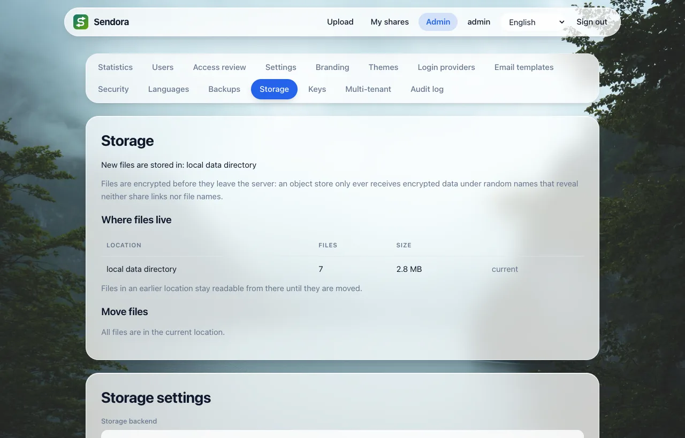

# Object storage

Where Sendora keeps the contents of shared files, how to move them to an S3-compatible service, Azure Blob Storage or Google Cloud Storage, and what the storage provider can and cannot see.

Applies to version 0.3.0.

[Back to the documentation index](README.md) · [Configuration](configuration.md) · [Threat model](THREAT-MODEL.md) · [File format](FILE-FORMAT.md)

## 1. Overview

| Backend | `storage_backend` | Where files go |
|---|---|---|
| Local data directory (**default**) | `local` | `DATA_DIR/shares/<link id>/<index>_<name>`, exactly as in every earlier release |
| S3-compatible | `s3` | AWS S3, MinIO, Cloudflare R2, Wasabi, Backblaze B2 (S3 API) and other services that speak the S3 API |
| Azure Blob Storage | `azure` | A container in a storage account (block blobs) |
| Google Cloud Storage | `gcs` | A bucket, through the Cloud Storage JSON API |

- **Nothing changes for existing installations.** `local` stays the default; a data directory from 0.1.x is used as it is, byte for byte.
- **Encryption stays in Sendora.** Every share file is encrypted with the share file format v2 ([FILE-FORMAT.md](FILE-FORMAT.md), chunked AES-256-GCM with a per-file key derived from the tenant's `files` key) **before it leaves the server**. An object store only ever receives ciphertext. The key never leaves the server.
- **Opaque object names.** Objects are called `files/<32 random hex characters>`; the name has no relation to the share link ID, the file name, the share or the database row. The mapping lives only in the encrypted database (`files.storage_id`, `files.object_key`).
- **Per-file location.** Every file record names the location it lives in. Switching the backend (or the bucket) only changes where **new** files go; earlier files stay readable from where they are until you migrate them (section 6).
- The database (`sendora.db`), upload parts in progress, temporary verified-download snapshots, branding images and local backups always stay in `DATA_DIR`. A persistent volume is still needed.



Configure the backend under **Admin → Storage** or with `SENDORA_STORAGE_*` variables (ConfigMap, Secret); see [configuration](configuration.md#object-storage). Settings that come from the deployment are read-only in the screen, secrets are write-only (the screen shows only whether one is stored), and every change needs a step-up re-authentication and is recorded in the audit log.

## 2. Backends

### 2.1 Local (default)

No settings. Files are written to `DATA_DIR/shares/<link id>/` with the same names and permissions as before. Also when another backend is selected, Sendora creates the (then empty) share directory: it is the claim that keeps share link IDs unique.

### 2.2 S3-compatible

| Setting | Meaning |
|---|---|
| `storage_s3_endpoint` | Empty for AWS S3; otherwise the service URL, for example `https://s3.eu-central-1.wasabisys.com` |
| `storage_s3_region` | Signing region (default `us-east-1`; required). Services that ignore it accept `us-east-1`; R2 uses `auto` |
| `storage_s3_bucket` | Bucket name (3–63 lowercase letters, digits, dots and hyphens; S3 naming rules) |
| `storage_s3_prefix` | Folder inside the bucket (default `sendora/`) |
| `storage_s3_path_style` | `true` for `https://host/bucket/key` addressing (MinIO and most self-hosted services); `false` for virtual-hosted `https://bucket.host/key` (AWS) |
| `storage_s3_auth` | `static` (access key and secret key) or `default` (AWS default credential chain) |
| `storage_s3_access_key`, `storage_s3_secret_key` | Static credentials; the secret key is write-only, use `SENDORA_STORAGE_S3_SECRET_KEY_FILE` |

Examples:

| Service | Endpoint | Region | Path style |
|---|---|---|---|
| AWS S3 | *(empty)* | the bucket's region, e.g. `eu-central-1` | `false` |
| MinIO (same cluster) | `http://minio.minio.svc:9000` | `us-east-1` | `true` |
| Cloudflare R2 | `https://<account id>.r2.cloudflarestorage.com` | `auto` | `true` |
| Wasabi | `https://s3.eu-central-2.wasabisys.com` | `eu-central-2` | `false` |
| Backblaze B2 | `https://s3.eu-central-003.backblazeb2.com` | `eu-central-003` | `true` |

Uploads up to 8 MiB are one `PutObject`; larger files are multipart uploads with 8 MiB parts (larger parts for files above about 78 GiB), each part buffered in memory. A failed upload is aborted (`AbortMultipartUpload`), so no parts are left behind. Sendora asks the SDK for checksums only where the service requires them, because not every S3-compatible service supports the newer default CRC checksums; integrity is ensured by GCM and the SHA-256 recorded at upload anyway.

### 2.3 Azure Blob Storage

| Setting | Meaning |
|---|---|
| `storage_azure_account` | Storage account name (3–24 lowercase letters and digits) |
| `storage_azure_container` | Container name (3–63 lowercase letters, digits and single hyphens) |
| `storage_azure_endpoint` | Empty for `https://<account>.blob.core.windows.net/`; set it for sovereign clouds, private endpoints with another name, or Azurite (`http://127.0.0.1:10000/devstoreaccount1`) |
| `storage_azure_prefix` | Folder inside the container (default `sendora/`) |
| `storage_azure_auth` | `shared_key`, `sas` or `identity` |
| `storage_azure_account_key` | Account key for `shared_key` (write-only) |
| `storage_azure_sas_token` | SAS token for `sas` (write-only; a leading `?` is removed) |

Files are uploaded as block blobs in 8 MiB blocks (two in parallel); the block list is committed only when every byte arrived, and the service discards uncommitted blocks of a failed upload.

Examples:

| Setup | Endpoint | Auth |
|---|---|---|
| Azure public cloud, AKS workload identity (preferred) | *(empty)* | `identity` |
| Azure public cloud, container SAS | *(empty)* | `sas` |
| Azure public cloud, account key | *(empty)* | `shared_key` |
| Azure Government / Azure China | `https://<account>.blob.core.usgovcloudapi.net/` / `https://<account>.blob.core.chinacloudapi.cn/` | any |
| Private endpoint | *(empty)*: the standard name resolves to the private address through the `privatelink` DNS zone | any |
| Azurite (local tests) | `http://127.0.0.1:10000/devstoreaccount1` | `shared_key` with Azurite's well-known development key |

Sendora does not create the container: create it first, private (no anonymous access), in an account with
*Secure transfer required* and minimum TLS 1.2. The `shared_key` and `sas` rows were tested against Azurite
(upload, share, download with a matching SHA-256, one opaque encrypted blob per file in the container).

**AKS with workload identity** (no key in the cluster; `DefaultAzureCredential` reads what the workload
identity webhook injects):

```sh
az storage account create -g rg-sendora -n sendorafiles --sku Standard_ZRS --https-only true \
  --min-tls-version TLS1_2 --allow-blob-public-access false
az storage container create --account-name sendorafiles -n shares --auth-mode login
az identity create -g rg-sendora -n sendora-files
az role assignment create --role "Storage Blob Data Contributor" \
  --assignee "$(az identity show -g rg-sendora -n sendora-files --query clientId -o tsv)" \
  --scope "$(az storage account show -g rg-sendora -n sendorafiles --query id -o tsv)/blobServices/default/containers/shares"
az identity federated-credential create -g rg-sendora --identity-name sendora-files -n sendora \
  --issuer "$(az aks show -g rg-aks -n my-aks --query oidcIssuerProfile.issuerUrl -o tsv)" \
  --subject system:serviceaccount:sendora:sendora --audience api://AzureADTokenExchange
```

```yaml
# ServiceAccount sendora (namespace sendora)
metadata:
  annotations:
    azure.workload.identity/client-id: "<clientId of sendora-files>"
# Pod template of the Deployment
metadata:
  labels:
    azure.workload.identity/use: "true"
# Container environment (ConfigMap)
SENDORA_STORAGE_BACKEND: azure
SENDORA_STORAGE_AZURE_ACCOUNT: sendorafiles
SENDORA_STORAGE_AZURE_CONTAINER: shares
SENDORA_STORAGE_AZURE_AUTH: identity
```

**Container SAS** (any cluster; rotate it before it expires). A SAS signed with the account key can be valid for
months; a user delegation SAS (`--as-user`) is limited to seven days and therefore not suited for a stored
setting.

```sh
az storage container generate-sas --account-name sendorafiles -n shares --permissions racwdl \
  --expiry 2027-06-30T00:00Z --https-only --auth-mode key -o tsv > sas-token
kubectl -n sendora create secret generic sendora-azure --from-file=sas-token=./sas-token
```

```yaml
# Container environment, with the Secret mounted read-only at /run/secrets/azure
SENDORA_STORAGE_BACKEND: azure
SENDORA_STORAGE_AZURE_ACCOUNT: sendorafiles
SENDORA_STORAGE_AZURE_CONTAINER: shares
SENDORA_STORAGE_AZURE_AUTH: sas
SENDORA_STORAGE_AZURE_SAS_TOKEN_FILE: /run/secrets/azure/sas-token
```

The `_FILE` variables must name a regular file (a mounted Secret is one). In multi-tenant mode the same fields
with `PLATFORM_` in front (`SENDORA_PLATFORM_STORAGE_AZURE_ACCOUNT`, ...) configure the platform default storage.

### 2.4 Google Cloud Storage

| Setting | Meaning |
|---|---|
| `storage_gcs_bucket` | Bucket name |
| `storage_gcs_endpoint` | Empty for `https://storage.googleapis.com`; set it only for an emulator such as fake-gcs-server |
| `storage_gcs_prefix` | Folder inside the bucket (default `sendora/`) |
| `storage_gcs_auth` | `service_account` (JSON key), `default` (Application Default Credentials) or `none` (only allowed together with a custom endpoint, for emulators) |
| `storage_gcs_credentials_json` | Service account JSON key for `service_account` (write-only; `SENDORA_STORAGE_GCS_CREDENTIALS_JSON_FILE` with a mounted key file is the usual form) |

Sendora talks to the Cloud Storage JSON API directly over HTTPS with `golang.org/x/oauth2/google` for tokens, instead of the official client library, which pulls in gRPC, protobuf and OpenTelemetry for the five calls Sendora needs. Uploads are single media uploads with a known length: the object exists only once the request completed.

## 3. Credentials and identity

Prefer an identity of the workload over long-lived keys.

| Provider | Options | Minimum permissions |
|---|---|---|
| AWS S3 | `static` access key; or `default`: the AWS default chain — environment variables, shared config files, **web identity (EKS IRSA)**, **EKS Pod Identity** / ECS task role, EC2 instance profile | `s3:PutObject`, `s3:GetObject`, `s3:DeleteObject`, `s3:AbortMultipartUpload` on `arn:aws:s3:::<bucket>/<prefix>*`; `s3:ListBucket` on the bucket (condition `s3:prefix` = `<prefix>*`) |
| S3-compatible | Static access key of a user/application key restricted to the bucket | Read, write, delete and list on the bucket (or prefix) |
| Azure | `shared_key` (account key: full access to the account, least preferred); `sas` (container SAS); `identity`: `DefaultAzureCredential` — **AKS workload identity**, managed identity, environment variables (service principal), Azure CLI | Role **Storage Blob Data Contributor** on the container (identity). A SAS needs the permissions **read, add, create, write, delete and list** on the container, HTTPS only, with an expiry you rotate before |
| GCS | `service_account` JSON key; `default`: Application Default Credentials — **GKE workload identity** / the metadata server, `GOOGLE_APPLICATION_CREDENTIALS`, gcloud user credentials | **roles/storage.objectUser** on the bucket (or a custom role with `storage.objects.create`, `get`, `delete`, `list`). OAuth scope `devstorage.read_write` |

Listing is used by `sendora-db verify-files` (orphan objects) and by the pruning of remote backup copies; the connection test writes, reads and deletes one object.

Credentials are stored in the SQLCipher-encrypted database, like the SMTP password, both as settings and as part of the storage location they were used with (section 5). With a `_FILE` variable they are read from a mounted Secret at every start.

**Redirecting credentials.** When a secret is stored, changing the place it is sent to — `storage_s3_endpoint` or `storage_s3_access_key` for the S3 secret key, `storage_azure_endpoint` or `storage_azure_account` for the Azure account key or SAS token, `storage_gcs_endpoint` for the GCS key — requires typing the secret again. An administrator session can therefore not send a stored key (or, for GCS, OAuth tokens minted from it) to a server of its choice. Changing storage settings and testing a connection also need a step-up.

## 4. Object layout and what the provider can see

| Object | Content |
|---|---|
| `<prefix>files/<32 hex>` | One share file, encrypted (format v2) |
| `<prefix>backups/sendora-encrypted-<date>-<time>-<random>.db` | Remote copy of a database backup (SQLCipher-encrypted), when `backup_remote_enabled` |
| `<prefix>probe/<16 hex>` | 64 random bytes written, read and deleted by a connection test (seconds) |

The provider **can** see:

- that ciphertext objects exist, how many, when they are written, read and deleted, and from which address (access logs);
- each object's **size**: the plaintext size plus 53 bytes of header and 16 bytes per 64 KiB chunk (no padding), so sizes reveal approximate file sizes;
- read patterns: a download reads the object from start to end; previews and resumed downloads read ranges;
- the size and age of database backups (but not their contents).

The provider **cannot** see file contents, file or share names, share link IDs, descriptions, accounts or any key. It cannot tell which files belong to the same share (names are random; upload times may correlate). It cannot change a file unnoticed: every chunk is authenticated with AES-GCM, and the file ID in the header is bound to the database row, so a modified, truncated, extended, reordered, replayed or swapped object is refused on download (409, `file_decrypt_failed`) and reported by `verify-files`. It **can** delete objects or serve an old version of a replaced object; for Sendora that is an availability problem (`verify-files` reports `missing` or a failing check), not a confidentiality problem. Objects are never overwritten in normal operation: each upload and each migration writes a new random key.

## 5. Locations and switching backends

Each distinct place (backend, endpoint, region, bucket or container, prefix) becomes a row in `storage_locations` the first time it is used, together with the configuration and credentials it was used with. `files.storage_id` points to it (`0` = the local data directory). Changing only the credentials of the same place updates the stored copy (key rotation).

So switching from S3 to Azure, or to another bucket, never breaks earlier files: they are read from their old location with the credentials stored for it, until they are migrated or expire. Keep the old bucket and its credentials valid until the migration has finished. The Storage tab lists every location with its number of files and bytes and marks the current one.

Saving a changed remote configuration first runs a connection test (write, read, delete a probe object, 30 seconds); if it fails, nothing is saved (`storage_connection_test_failed` in the audit log). At start-up an incomplete storage configuration (for example `storage_backend=s3` without a bucket) stops the server with a message naming the problem; reachability is not checked at start.

## 6. Migration

Migration copies every file that is not in the current location to the current location:

1. read the stored ciphertext from the old location and write it under a new random key;
2. **verify the copy** by reading it back completely: header, file ID, every GCM chunk tag, the plaintext length and the SHA-256 recorded at upload;
3. switch the file record to the new location (only if the record did not change meanwhile; otherwise the copy is removed and the file counted as skipped);
4. delete the source.

Legacy plain files (uploaded before 0.1.2) are **encrypted on the way**; their SHA-256 is recorded if none was. Without a file key (plaintext test store) they are never copied to an object store. A file that fails any step stays readable in its old location, its partial copy is removed, and the run continues; it is counted as failed. Migration back to `local` writes files into their share directory in the original layout.

**From the web interface:** Admin → Storage → *Migrate files* (step-up). The job runs in the background and survives closing the browser; the tab shows progress (copied, failed, skipped, bytes) and can cancel it. The old copy of each migrated file is deleted **15 minutes** after the switch, so downloads that opened it can finish. A restart interrupts a running job (it is marked failed and can be started again; finished files are not copied twice). Audit records: `storage_migration_requested` (before), `storage_migration_started`, then `storage_migration_finished`, `storage_migration_failed` or `storage_migration_cancelled` with the counts.

**From the command line:**

```sh
sendora-db storage-migrate -source /data/sendora.db -data-dir /data -key-file /run/secrets/sendora/database.key [-dry-run]
```

The target is the storage configuration in the database, overridden by the same `SENDORA_STORAGE_*` / `*_FILE` variables the server uses, so a Kubernetes Job with the server's ConfigMap and Secret migrates to the same place. `-dry-run` only prints the target and the number of files. Sources are deleted right after each verified switch, so stop the server first (or accept that a download of a file being moved at that moment may fail). Ctrl-C stops after the current file. The run is recorded in the audit log (actor `sendora-db`) and in the migration history shown on the Storage tab; the exit status is non-zero when a file failed.

## 7. Deleting remote objects

Removing a files row — deleting a file or share, expiry clean-up, deleting or erasing a user — queues the remote object for deletion **in the same database transaction** (trigger `files_remote_deleted`), so no code path can forget an object. A background pass deletes queued objects right after the change and at every maintenance run (every 10 minutes); a failure is retried with a growing delay (10 minutes, up to 6 hours between attempts). The Storage tab shows the number of pending deletions. Local files keep their directory-based removal.

For erasure requests this means the object is deleted within seconds when the store is reachable. Copies kept by the provider's versioning or soft delete remain until their retention ends (section 9).

## 8. Remote backup copies

With `backup_remote_enabled=true` every **automatic** daily backup (already SQLCipher-encrypted with the database key) is also uploaded to `<prefix>backups/` of the current backend, and remote copies beyond `backup_keep` are deleted (same name pattern as locally: pre-import and manual backups are never pruned automatically and are not copied). Audit records: `backup_remote_copied`, `backup_remote_failed`, `backup_remote_pruned`. The option needs a non-local backend; saving it with `local` is refused. The database key is never uploaded: keep its separate backup as before.

Share files are still not part of a database backup. With an object store, protect them with the provider's own durability features (section 9).

## 9. Recommended bucket settings

- **Private access only**: block all public access (S3 Block Public Access, Azure *Allow Blob anonymous access* off, GCS uniform bucket-level access with public access prevention).
- **TLS only**: a bucket policy that denies non-TLS requests (`aws:SecureTransport=false`), *Secure transfer required* and minimum TLS 1.2 on Azure. Sendora accepts `http://` endpoints only for loopback and private addresses, single-label names and `.svc`, `.cluster.local`, `.local`, `.internal` hosts (MinIO, Azurite or fake-gcs-server next to Sendora).
- **Versioning or soft delete** against accidental or malicious deletion, with a retention that matches your deletion promises: deleted and erased files stay recoverable at the provider until the versions expire, which you must state in your retention and erasure statements (GDPR). Content stays encrypted, but the database key decrypts it.
- **Lifecycle rules**: abort incomplete multipart uploads after 1 day (S3); optionally expire `backups/` objects older than your backup policy as a second safeguard; expire non-current versions.
- **Encryption at rest by the provider** (SSE-S3/SSE-KMS, Azure SSE, GCS default encryption) is welcome as an extra layer; Sendora does not depend on it.
- **One bucket or prefix and one set of credentials per installation**, least privilege (section 3), no other writers.
- Choose the **region** for your data-residency requirements; the provider is a sub-processor of encrypted data (see [DATA-FLOW.md](compliance/DATA-FLOW.md)).
- Monitor the provider's access logs if available, and run `sendora-db verify-files` periodically: it also lists objects under `files/` that no record refers to.

## 10. Kubernetes and network

- The recommended NetworkPolicy ([deploy/networkpolicy.yaml](../deploy/networkpolicy.yaml), applied separately) already allows egress to TCP 443 on any address except link-local, which covers AWS S3, Azure Blob Storage, Google Cloud Storage, R2, Wasabi and B2. A MinIO or other service on another port (for example 9000) needs an extra egress rule.
- Workload identity needs the usual setup: an annotated ServiceAccount (IRSA `eks.amazonaws.com/role-arn`, Azure `azure.workload.identity/client-id` plus the pod label `azure.workload.identity/use: "true"`, GKE `iam.gke.io/gcp-service-account`). Azure and GCS workload identity also need egress to their token endpoints (443) and, for GKE, to the metadata server, which the example policy blocks (169.254.0.0/16): add a rule for `169.254.169.254/32` port 80 (GKE metadata server) only when you use it.
- With an object store the persistent volume only holds the database, local backups and temporary upload/download data; size it for the largest concurrent uploads and verified downloads.

## 11. Multi-tenant mode

In multi-tenant mode ([MULTI-TENANT.md](MULTI-TENANT.md) §8) each tenant sets up
its own storage in Admin → Storage; a new tenant has none, and uploads are
refused until it does. `SENDORA_STORAGE_*` is ignored there.

- **Own storage** (allowed by default; the platform can forbid it per tenant):
  the form of this page, explicit credentials only (no AWS default chain/IRSA,
  Azure managed or workload identity, or Google application default credentials:
  those are the platform's), and the endpoint must not resolve to loopback,
  private, link-local, CGNAT or metadata addresses (checked when saved and on
  every connection, unless the platform allows private targets for the tenant).
  The platform console shows only the kind and the usage.
- **Platform bucket** (optional offer per tenant): the platform default
  (*Platform settings → Default storage* or `SENDORA_PLATFORM_STORAGE_*`, the
  variables of this page with `PLATFORM_` in front) under
  `<platform prefix>tenants/<tenant id>/` (`Config.WithPrefix`). Each tenant's
  backend sees only its prefix, and every object is encrypted with that tenant's
  own file key.
- **Local disk** of the server: only when the platform offers it per tenant.
- The migration job, remote backup copies, the deletion queue and
  `sendora-db verify-files`/`storage-migrate` (with `-tenant <id>`) work per
  tenant. Deleting a tenant removes its prefix in the platform bucket and
  Sendora's objects (`files/`, `backups/`, `probe/`) in its own storage.
