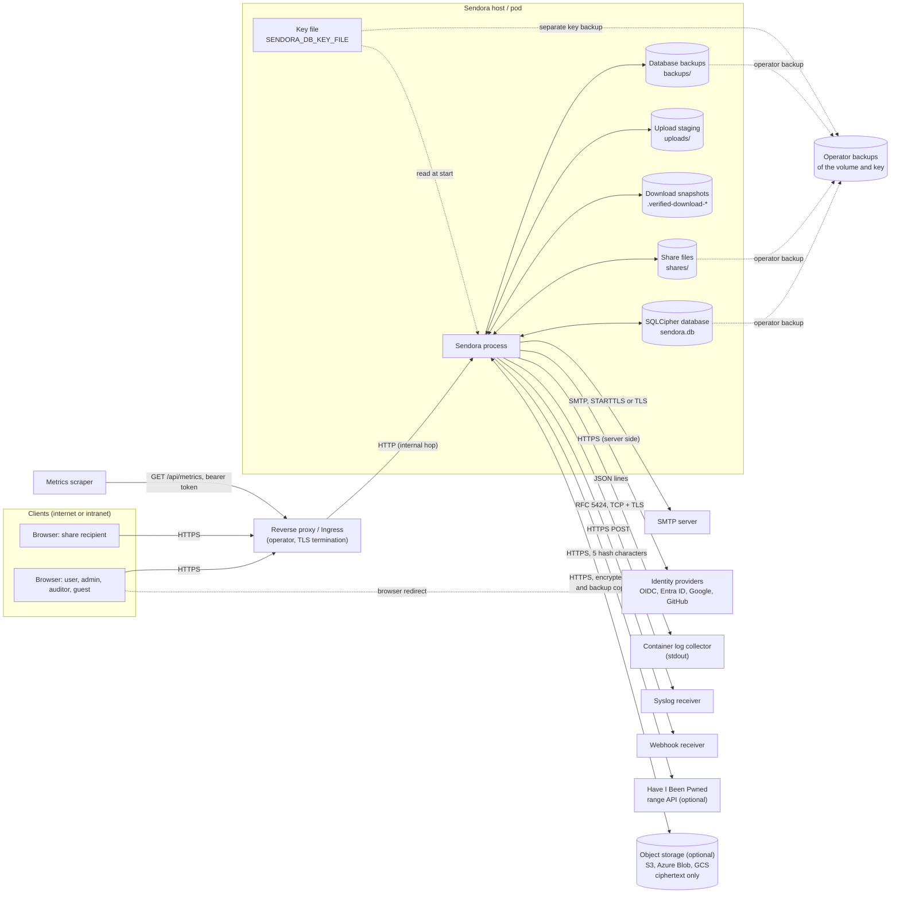

# Data flows

This document shows which data moves between Sendora, its users and the systems around it, in which direction, over which protocol, and how each flow is encrypted and authenticated. It supports records of processing, data-protection impact assessments and network reviews. "Operator" means whoever runs the Sendora deployment.

Written for version 0.2.0 (the optional object storage, flows 20–21, and multi-tenant mode, section 2.4, came with 0.2.0). The Cluster flavour of 0.3 is not covered yet ([cluster/QUICKSTART.md](../cluster/QUICKSTART.md), [ENCRYPTION.md](../ENCRYPTION.md)).

[Back to the compliance index](README.md)

## 1. Diagram

Solid arrows are network or file flows started by the component at the tail; dotted arrows are start-up reads, browser redirects or operator processes. The metrics scraper may also reach Sendora directly inside the cluster instead of through the proxy.

## 2. Flows

### 2.1 Inbound (clients to Sendora)

| # | Flow | Data | Direction | Protocol | Encryption in transit | Authentication |
|---|---|---|---|---|---|---|
| 1 | Browser → proxy | API calls, uploads (file contents, names), sign-in credentials, MFA codes and assertions | in | HTTPS | Operator TLS at the proxy | Bearer access token (15 min) and `HttpOnly` refresh cookie; credentials at sign-in |
| 2 | Recipient → proxy | Share page, unlock (share password), download and preview requests; responses carry file contents | in / out | HTTPS | Operator TLS | Share link ID (unguessable, ~86 bits); optional share password (unlock token) |
| 3 | Proxy → Sendora | Same as 1 and 2, plus `X-Forwarded-For` / `X-Forwarded-Proto` | in | HTTP (Sendora has no TLS listener) | **None from Sendora.** Keep this hop on a trusted network, a pod-local path, or add the operator's own mTLS / service mesh | Forwarded headers are believed only from `SENDORA_TRUSTED_PROXIES` |
| 4 | Health and readiness | `/api/health`, `/api/health/ready`: status and check names only | in | HTTP | Operator | None (public) |
| 5 | Metrics scraper → Sendora | Counters and gauges, no personal data | in | HTTP(S) | Operator TLS if routed through the proxy | `Authorization: Bearer <token>`; endpoint off unless `SENDORA_METRICS_TOKEN_FILE` is set |

### 2.2 Local storage (inside the host or pod)

| # | Flow | Data | Encryption at rest | Access control |
|---|---|---|---|---|
| 6 | Key file → Sendora | 32-byte database key, read once at start | None (it is the key). Operator protects it (Secret, file mode) | Owner root or service user; no group-write, no world access, else Sendora refuses to start |
| 7 | Sendora ↔ database | Accounts, share metadata (names, descriptions, file names), settings, secrets, sessions, audit log | SQLCipher 4.20.0 (AES-256) | Process only |
| 8 | Sendora ↔ share files | File contents (local backend, the default) | AES-256-GCM per file (uploads since 0.1.2). Directory names are the link IDs and file names are `<index>_<original name>`, both unencrypted. With an object store (flow 20) the share directory stays empty | `DATA_DIR/shares` and `DATA_DIR/uploads` are created with mode `0700` |
| 9 | Sendora ↔ upload staging | Parts of files being uploaded (`uploads/<session>/<index>.part`) | **None** (plain while in progress); removed on completion, abort or after 24 h | `DATA_DIR/shares` and `DATA_DIR/uploads` are created with mode `0700` |
| 10 | Sendora ↔ download snapshots | Temporary plain copy of a file for a verified download | **None**; removed after the transfer and at every start | Data directory |
| 11 | Sendora → database backups | Copy of the database (no share files); automatic every 24 h while `backups_enabled`, kept `backup_keep` (default 7) | SQLCipher, same key | Administrators can download them (step-up, audited) |
| 12 | Host → operator backups | Whatever the operator copies: the volume (database, share files, backups) and, separately, the key | Operator responsibility; the database and file contents stay encrypted, names on the volume do not | Operator |

### 2.3 Outbound (Sendora to other systems)

| # | Flow | Data | Direction | Protocol | Encryption in transit | Authentication |
|---|---|---|---|---|---|---|
| 13 | Sendora → SMTP server | Recipient address, name, language; verification codes; reset, MFA-reset and invitation links; share links; share and file names (download and share notifications); security notifications | out | SMTP (`smtp_port`, default 587) | `smtp_tls`: `starttls` (default) or `tls`, minimum TLS 1.2 with certificate verification; `none` sends in clear | SMTP user and password from settings / `SENDORA_SMTP_PASS_FILE` (optional) |
| 14 | Browser ↔ identity provider | Authorisation request with `state`, `nonce`, PKCE challenge; the user's sign-in at the provider | redirect | HTTPS | Provider TLS | At the provider (its MFA applies) |
| 15 | Sendora → identity provider | Discovery, JWKS, code-for-token exchange; receives ID token claims (subject, email, name) | out | HTTPS | TLS with certificate verification; 5 s timeout, max. 3 redirects, no proxy; loopback, link-local and metadata addresses refused | Client ID and client secret |
| 16 | Sendora → stdout | Audit records as JSON lines (`{"sendora_audit":{…}}`) and the `chain_head` heartbeat | out | Container log stream | Operator's log pipeline | — |
| 17 | Sendora → syslog | Same records, RFC 5424, TCP with octet counting | out | TCP | TLS by default (`audit_forward_syslog_tls`, verified against system roots); plain TCP if switched off | Server certificate only (no client certificate) |
| 18 | Sendora → webhook | Same records as JSON arrays (≤100 per POST) | out | HTTPS (HTTP only to `localhost`) | TLS verified; redirects not followed | Optional bearer token from `SENDORA_AUDIT_FORWARD_WEBHOOK_TOKEN_FILE` |
| 19 | Sendora → Have I Been Pwned | First 5 hex characters of the SHA-1 of a new password (k-anonymity), `Add-Padding: true` | out | HTTPS to `api.pwnedpasswords.com` | TLS | None. Only when `password_breach_check_online=true` (default off) |
| 20 | Sendora ↔ object storage (optional, `storage_backend` = `s3`, `azure` or `gcs`) | Share files **encrypted before upload** (format v2) under random names `files/<32 hex>`; reads of whole objects or ranges; deletions; a short probe object for connection tests. No file names, share link IDs, metadata or keys | out (write, read, delete) | HTTPS (S3 API, Azure Blob REST, GCS JSON API); `http://` only to loopback/private/cluster-internal hosts | TLS with certificate verification | Static keys, SAS token, account key or service account key from settings / `*_FILE`; or workload identity (IRSA, EKS Pod Identity, AKS workload or managed identity, GKE workload identity) |
| 21 | Sendora → object storage (optional, `backup_remote_enabled`) | Copies of the automatic database backups (SQLCipher-encrypted), `backup_keep` retained | out | HTTPS | TLS | As flow 20 |

Audit records may contain personal data (username, target labels, optional IP address); see [PERSONAL-DATA.md](PERSONAL-DATA.md). Forwarding destinations on link-local (cloud metadata) addresses are refused; private and loopback addresses are allowed.

The object storage provider (flows 20–21) is a sub-processor of **encrypted** data only: it sees object sizes, times and access patterns, never contents, names or keys ([STORAGE.md](../STORAGE.md#4-object-layout-and-what-the-provider-can-see)). Workload identity also contacts the cloud's token service (STS, Entra ID, Google OAuth or the metadata server).

The server makes no other outbound connections. The web interface loads nothing from third parties: its Content Security Policy limits scripts, styles, images, media and API calls to the Sendora origin (`'self'`, plus `data:`/`blob:` for images and media and inline style attributes). The setting `ui_use_unsplash` is passed to the interface but no code in 0.2.0 acts on it.

### 2.4 Multi-tenant mode (optional)

- Requests are routed by host: `<slug>.<base domain>` or a verified custom domain to that tenant's own server and database (`DATA_DIR/tenants/<random id>/`), `admin.<base domain>` to the platform console (`DATA_DIR/platform.db`). No request of one tenant reads another tenant's database or directory.
- The platform database holds tenant names, subdomains, custom domains, quotas, counts (users, stored bytes), the storage configuration, platform administrators (username, email, bcrypt hash, TOTP secret) and the platform audit log. It holds no tenant user, share or file data.
- Outbound: DNS TXT lookups for custom-domain verification; email through the tenant's SMTP server or, when the tenant has none, the platform's default SMTP server (`SENDORA_PLATFORM_SMTP_*`).
- Object storage per tenant (flows 20–21 per tenant): the tenant's own S3, Azure Blob or GCS account, or a storage offer of the platform (the platform bucket under `<prefix>tenants/<tenant id>/`, or the server's disk). Files are encrypted with the tenant's own file key before upload; the console sees only the kind and usage of a tenant's own storage. A new tenant has no storage until one is set up.
- Targets a tenant's administrator configures (SMTP server, OIDC issuer, audit webhook and syslog, own storage endpoint) must not resolve to loopback, private, link-local, CGNAT or metadata addresses; the check runs when saved and on every connection (`internal/netguard`), unless the platform allows private targets for that tenant.
- The console reads only counts from a tenant (when the tenant is open) and writes records into the tenant's audit log for platform actions affecting it.

## 3. Operator checklist for the flows

- Terminate TLS for flows 1, 2 and (if external) 5; set `APP_URL` to the https origin and `SENDORA_TRUSTED_PROXIES` to the proxy addresses.
- Protect flow 3 (proxy to Sendora): same host, same pod, a private network segment or a mesh with mTLS. A recommended NetworkPolicy for the example Kubernetes manifest is in [deploy/networkpolicy.yaml](../../deploy/networkpolicy.yaml) (applied separately; it needs a CNI that enforces NetworkPolicy).
- Use `starttls` or `tls` for SMTP (flow 13), TLS for syslog (flow 17) and HTTPS for the webhook (flow 18).
- Restrict egress to the SMTP server, identity providers, forwarding destinations and, if enabled, `api.pwnedpasswords.com`.
- Encrypt and protect the volume and its backups (flows 9, 10, 12) and keep the key apart from the data.
- With an object store (flows 20–21): private bucket, TLS-only policy, least-privilege credentials or workload identity, a region that meets your residency requirements, versioning/soft-delete retention that matches your erasure statements, and egress to the provider's endpoints (443).
